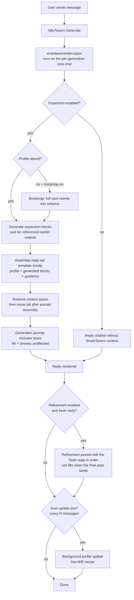

# SmartTavern

A single, self-contained SillyTavern UI extension that aims to deepen the roleplay and introduce the agentic-based workflow into your roleplay.

1. **Living per-chat character profiles** — a dynamic, LLM-maintained bio with a user-defined schema, stored **per chat** and fully independent of the parent character card.
2. **Dual reasoning pipelines** — two user-editable step lists, each entry an isolated LLM call, that run together without interfering:
   - **Expansion** (before the reply): steps generate context that assembles into a configurable prompt tail for the upcoming reply. Independent steps can run together; explicit output references preserve dependencies. SmartTavern **augments** SillyTavern's prompt assembly; presets and World Info keep working.
   - **Refinement** (after the reply): passes audit and surgically edit the freshly generated reply in order — optionally hidden behind a veil until the final pass lands.

No server plugin, no build step — install via the default extension installer.

The generation WILL take longer, since multiple agents will be reasoning and adding context or refining the actual reply. But you can surgically prompt an agent to focus on specific parts YOU don't like or YOU want to be attended more. From simple repetition and prose check, up to additional descriptions/realistic dialogue or whatever is annoying you personally.

---
## Screenshot

 


## Installation and quickstart

**Via the extension installer (recommended):**
`Extensions → Manage extensions → Install extension`, then paste the git repository URL.

**Manual:** copy this folder into

```
SillyTavern/public/scripts/extensions/third-party/SmartTavern/
```

and restart / reload SillyTavern.

Recommended companion: the built-in **Connection Manager** extension (enabled by default in recent ST builds). It stores the saved connection profiles that SmartTavern uses for per-step and per-updater routing. Without it, SmartTavern still works — every internal call simply uses the currently active connection (one warning is shown).

Right-click on the character avatar (long press on mobiles) will open the context window for you to configure.

## How it works



Key implementation facts (verified against ST 1.13–1.19 source):

- The extension registers a `generate_interceptor`. ST calls it with the **per-generation core chat array** — a filtered/mapped *copy* of the real history. The injected state block therefore feeds World Info scanning and the final prompt for that one generation **without ever leaking into the saved chat history**.
- **Two independent pipelines run together.** *Expansion* runs inside the interceptor before generation and injects its outputs into the reply prompt; *refinement* runs after the reply is rendered (`CHARACTER_MESSAGE_RENDERED`), editing the fresh draft in place. Each has its own step list, enable toggle and per-step Connection Manager routing — disabling either leaves the other fully functional.
- **Refinement (and the veil) only ever touches a freshly generated reply.** The interceptor marks each real generation; only the first rendered character reply after that mark is refined. Chat loads, scrollback, swipe views and a new chat's greeting (`first_message`) are never refined or veiled.
- The default position is **End of assembled reply prompt**. SmartTavern first inserts a marked, ephemeral reservation into the core chat so ST includes the tail in its context budgeting. At `CHAT_COMPLETION_PROMPT_READY`, it removes the reservation and appends the assembled tail as the last message with the selected role. Other preset instructions remain intact. Markers distinguish this request from unrelated internal requests.
- Text-completion mode uses `GENERATE_AFTER_COMBINE_PROMPTS`, formats the tail using the active instruct settings (or named plain text), and restores an assistant generation cue after it. If a custom formatter prevents safe relocation, markers are stripped and the assessment stays at its budgeted history position. Backend-specific post-processing may still reshape messages after these hooks; role behavior depends on the provider.
- The older history anchors remain available for comparisons. There, each block has its own output role and uses the injection header/footer. Prompt-end mode instead uses the **Prompt-tail role** and **Reply prompt-tail template** settings for the complete tail.
- Generation instructions always go to the block model as a user request. Only generated output is injected into the main reply prompt. Assistant context supplies prior assessments; it does not force a provider to import them into a private reasoning channel or accept fabricated thought signatures.
- Existing configurations migrate once to prompt-end injection with assistant role. Step prompts and connection profiles are preserved. The redundant final consolidation pass, its editor, and its saved settings have been removed: assembling the template makes no extra LLM call. After migration, manually chosen history anchors and role settings persist normally.
- The former single *Pipeline mode* migrated into the two independent pipelines: refinement users' step lists moved to **Refinement passes** (expansion gets its default preset back), while expansion users keep their steps and gain the default refinement preset. Both pipelines default to on and can be toggled separately.
- Profile updates fire on `MESSAGE_RECEIVED` once `chat.length - updatedAt >= updateInterval` messages have accumulated for the character who just replied. They run in the background and merge with **little-to-no personality drift** (Personality / Values / Aspirations / Fears are held stable by the updater prompt). When refinement is enabled the update is deferred until the passes finish, so the updater reads the refined reply.
- All internal LLM calls go through one adapter:
  - with a **Connection Manager profile id** → `ConnectionManagerRequestService.sendRequest()` against that saved API/preset/instruct (no global state mutation); Chat Completion structured output uses the `response_format: json_schema` override payload;
  - without one (or on any error) → `generateRaw()` on the active connection (`responseLength` = token budget, `jsonSchema` passed through, lenient JSON parsing as fallback).
- **Expansion and refinement own their sampling settings.** Each step has a **Sampling** button below its prompt, with temperature (default 0.7), repetition penalty (1), presence penalty (0), and frequency penalty (0). These calls use the saved connection profile's routing, API/model and credentials, without importing its generation preset or instruct settings. Other generation parameters use provider defaults. Prompt content comes from SmartTavern's system prompt and the expanded step prompt; history, character definitions and living profiles enter through macros. Provider prompt post-processing can still reshape messages. Providers differ in which sampling controls they support; repetition penalty is omitted for OpenAI, Claude and Gemini chat sources.
- **Active-connection step calls and fallbacks use the same isolated sampling.** They use ST's Chat/Text Completion request services with connection routing only, without changing global ST settings. Older builds or other active API types need a saved Connection Manager profile for these calls. Planner, profile maintenance, Story Director and other non-step calls retain their existing preset behavior.
- Refinement starts from the render event without blocking that event's completion. Active-connection requests can then wait safely for `GENERATION_ENDED`, rather than hitting the foreground wait's 60-second safety timeout. Passes remain sequential, and profile maintenance follows refinement.
- Group chats: profiles are keyed by member avatar filename; the drafting member is resolved from the global `name2` (which ST sets to the currently-generating member), falling back to the last non-user message author.
- **Living description override** (Settings → *Replace the card description with the living profile*): the character card's description text is swapped for the stored living profile inside the assembled prompt. This covers every channel the description travels — the Prompt Manager's **Char Description** entry (chat completion marker prompt), the instruct Context Template story string (text completion) and the `{{description}}` macro in custom prompts — because all of them end up containing the same description text ST computed in `Generate()`. The swap happens on the per-generation prompt copy at `CHAT_COMPLETION_PROMPT_READY` / `GENERATE_AFTER_COMBINE_PROMPTS`; **the stored card is never modified**, and without a profile the original description is used. In group chats every member with a stored profile gets their slice swapped (including merged group-card descriptions).

## Using the floating panel

Everything is summoned as a compact panel over the chat window — no drawer digging:

- **Right-click any character avatar** in the chat (long-press on touch devices) → quick menu: *Edit living bio*, *Edit pipeline*, *Update bio now*, *Guided update…*, *Last result*.
- Other entry points: **Extensions (wand) menu → SmartTavern**, the **Open SmartTavern panel** button in the extension settings drawer, and the `/st-hud` toggle.
- Tabs: **Profile** (the character's living bio, editable in place — manual edits save automatically with source `manual`; each field header has a **wand** to regenerate that field alone and a **compass** for a guided regeneration with extra direction from you; the optional **Guidance** box feeds the next **Update** / **Rebuild** as one-shot extra direction that never overrides the schema or the card), **Steps** (two editors — expansion steps and refinement passes; cards collapse on header click), **Schema** (profile field editor), **Results** (the latest run of each pipeline — dry run or captured from the last generation), **Settings** (everything else).
- Drag the header to move the panel; double-click the header to reset to the default (left-center) position. Tab and position are remembered.
- `Esc` closes the panel (native popups keep priority).
- On screens ≤ 900 px the panel becomes a near-fullscreen sheet and dragging is disabled.
- **Disable floating UI** (Settings tab) hides every floating entry point and makes `/st-hud` a no-op; the settings drawer stays available.

## Configuration

Full settings live in the floating panel (Settings tab); the **Extensions → SmartTavern** drawer keeps the enable toggle, the panel button and a status line.

| Setting | Meaning |
| --- | --- |
| Enable SmartTavern | Master toggle for the pipeline injection |
| Enable expansion | Master toggle for the pre-reply context pipeline (on by default) |
| Enable refinement | Master toggle for the post-reply editing pipeline (on by default) |
| Refinement display | **Veiled** (default): the fresh reply is blurred in chat until the final pass lands — pass progress shows as chips on the message and a hold-to-peek button can partially unblur it. **Off**: every pass lands visibly. The veil only ever appears on a freshly generated reply — never on chat loads or a new chat's greeting. |
| Allow hold-to-peek | Shows the hold-to-peek button on the veil (on by default) |
| That's enough (veil button) | Stops refinement immediately and keeps the last completed pass, or the original draft if no pass has finished. The unfinished pass is discarded. |
| Skip pass (veil / activity log button) | Cancels only the currently running refinement pass and continues to the next pass using the last accepted draft. Late responses from the skipped request are discarded. |
| Save refinement passes as swipes | Appends changed revisions to the message swipes. Veiled runs keep only draft + final so the swipes cannot spoil the result. |
| Auto-update profiles | Background maintenance on `MESSAGE_RECEIVED` |
| Bootstrap profile on first message | First generation for a character = complete rewrite of the card into the schema |
| Replace the card description with the living profile | Swaps the card's description text for the stored profile inside the assembled prompt (Char Description entry, story string, `{{description}}` macro). The card itself is never modified; needs a stored profile, which the pipelines (or a manual **Rebuild**) create. |
| Update every N messages | Cadence per character (default 12) |
| Pipeline / updater chat lookback | How many recent messages the step prompts / updater see (default 24) |
| Step / updater max tokens | Token budgets for internal calls (default 512 / 1024) |
| Injection position | End of assembled reply prompt (default), or a history anchor for comparisons |
| Prompt-tail role | Assistant (default), User, or System for the complete tail |
| Reply prompt-tail template | Editable template assembled locally; defaults to profile + `{{steps}}` + instructions to use the assessments for the upcoming reply without repeating the notes |
| Injection depth | Used only with custom history depth: 0 = after the newest message, 1 = before it |
| Injection name / header / footer | Settings for history positions; `{{char}}` and other macros resolve |
| Profile schema fields | Rows: name + description — the JSON schema is built from this list (defaults: Brief Summary, Appearance, Background, Personality incl. sexual preferences, Aspirations, Fears, Values) |
| Expansion steps | Cards: enabled, name, role, per-step lookback, connection profile, prompt; reorder / duplicate / delete; defaults: **Physical Condition** → **Mental Condition** |
| Refinement passes | Same cards minus the role selector (passes are strictly sequential and work on the draft), plus an **Edit mode** select: **Surgical edits** (default) or **Full rewrite**. Defaults: **Body & Spatial Awareness** → **Character & Psychological Authenticity** → **Prose & Wording Polish** |
| Step execution | Expansion only: parallel where independent (default), or sequential. `{{step:Name}}` waits for that earlier step; `{{steps}}` waits for all earlier steps. Refinement passes are always strictly sequential. Isolated step requests can overlap without changing ST's global generation settings. |
| Step sampling | Button below each expansion/refinement prompt: temperature, repetition penalty, presence penalty, frequency penalty. Values are saved per step and preserved when duplicating. These replace preset sampling for step calls; supported controls depend on the API/model. |
| Step reasoning | Checkbox beside each expansion/refinement connection selector, **off by default**. On requests maximum effort through the provider adapter. If that value is explicitly rejected, retry on the same connection with high and remember the successful choice for that connection/model until reload. Off requests disabled thinking, rather than merely hiding thoughts. Models/adapters that cannot disable thinking report an error; Off is never silently replaced with low effort. The checkbox is unavailable for Text Completion connections. |
| Block role | Expansion steps only: role of each generated output when using a history anchor; prompt-end mode uses the global tail role. Refinement passes have no role selector. |
| Profile updater connection profile | Saved Connection Manager profile used by bootstrap/update/rebuild |
| Disable floating UI | Master switch for the floating panel, avatar context menu and wand-menu button |
| Run expansion / Run refinement (Results tab) | Dry run each pipeline: expansion runs its steps without injecting; refinement previews what the passes would change about the last character reply, saving nothing |

### Reasoning control

Reasoning is separate from the XML editing contract: a model can think before producing edit tags. On may increase latency substantially. Native Claude and Gemini use ST's effort-to-thinking-budget mapping; some models require reasoning or their adapter cannot explicitly disable it. Custom OpenAI-compatible endpoints receive an explicit `reasoning_effort` body field. Unsupported Off requests surface for review instead of retrying with thinking enabled. OpenAI reasoning modes omit incompatible temperature settings without changing the saved control. Planner, profile maintenance and other non-step calls retain their existing behavior.

### Refinement guardrails

Every completed refinement pass is checked only for an empty reply payload. An explicit `<audit>PASS</audit>` without a reply wrapper keeps the current draft. There are no length, similarity, placeholder, repetition, or tag-format filters for refinement. Other internal calls retain their generation sanity checks.

An empty result or exhausted generation error pauses refinement with **Retry pass**, **Skip Pass**, and **Review** buttons. Review opens the returned output in a scrollable window with **Accept**, **Retry**, and **Skip Pass**. Accept uses the reviewed result and continues; when it contains no reply, Accept keeps the current draft. Retry repeats the same prompt using the last accepted draft. Skip discards the failed output and continues to the next pass. Only accepted outputs become swipes or `{{step:Name}}` values. The same workflow applies to dry runs without changing chat.

**Skip pass** is also available while a request is running, in the veil and the expanded activity log. **That's enough** ends the whole refinement run. Global Stop and chat changes cancel pending rejection and review windows.

Each refinement pass streams progress to the activity display and the reply veil: **Waiting for the provider**, **Reasoning** when thinking tokens arrive, **Audit** when audit output arrives, and **Rewriting reply** when edit operations or revised prose arrive. Stages follow observable output, so a pass may skip stages (for example, a clean audit needs no rewrite). Providers that hide reasoning or buffer their response remain on Waiting until visible output arrives. Retries and connection fallback reset the status to Waiting.

### Step prompt macros

| Macro | Resolves to |
| --- | --- |
| `{{char}}` / `{{user}}` | Target character / your persona name |
| `{{card}}` | The character card flattened to text |
| `{{definitions}}` | The full stored profile as `## Field` blocks |
| `{{chat}}` | The last N messages as `Name: text` |
| `{{field:Name}}` | A single profile field (case-insensitive) |
| `{{step:Step Name}}` | An earlier step's output (case-insensitive) |
| `{{steps}}` | Earlier completed outputs in a step prompt; all generated outputs in the reply-tail template, in configured order |
| `{{draft}}` / `{{original_draft}}` | Refinement passes only: the current working draft / the original reply before any pass touched it. In surgical passes `{{draft}}` renders the numbered paragraphs; `{{draft_plain}}` gives the unnumbered working draft, `{{draft_paragraphs}}` forces the numbered rendering in any pass |
| `{{story}}` | The compiled scene directive text (Story Director; never contains secrets or future chapters) |
| `{{must}}` / `{{beat}}` / `{{chapter}}` / `{{ledger}}` | The required event / the current beat text / the current chapter line / the fact ledger |

These macros also work in the reply-tail template. Include `{{steps}}` or selected `{{step:Name}}` references to supply the generated assessments. `{{step:Name}}` and `{{steps}}` resolve against the list of the pipeline the prompt belongs to — a refinement pass never sees expansion outputs, and vice versa. Unknown macros are left intact for SillyTavern's own substitution pass. The Results tab shows the assembled reply context (expansion) and the final refined reply (refinement) so you can inspect exactly what each pipeline produced.

### Refinement guardrails

Every completed refinement pass is checked only for an empty reply payload. An explicit `<audit>PASS</audit>` without a reply wrapper keeps the current draft. There are no length, similarity, placeholder, repetition, or tag-format filters for refinement. Other internal calls retain their generation sanity checks.

An empty result or exhausted generation error pauses refinement with **Retry pass**, **Skip Pass**, and **Review** buttons. Review opens the returned output in a scrollable window with **Accept**, **Retry**, and **Skip Pass**. Accept uses the reviewed result and continues; when it contains no reply, Accept keeps the current draft. Retry repeats the same prompt using the last accepted draft. Skip discards the failed output and continues to the next pass. Only accepted outputs become swipes or `{{step:Name}}` values. The same workflow applies to dry runs without changing chat.

**Skip pass** is also available while a request is running, in the veil and the expanded activity log. **That's enough** ends the whole refinement run. Global Stop and chat changes cancel pending rejection and review windows.

### Surgical refinement (edit modes)

Every pass picks how it may change the draft — the point is speed: a pass that touches 10% of the reply should not re-emit (and re-bill, and re-wait for) the other 90%.

**Full rewrite** is the classic contract: the model reasons inside `<audit>…</audit>` and returns the complete revised reply inside `<revised_reply>…</revised_reply>`, or `<audit>PASS</audit>` to keep the draft.

**Surgical edits** (the default for the preset passes and new passes) splits the draft into paragraphs automatically (blank lines; fenced code blocks stay atomic; single-newline drafts fall back to line granularity) and numbers them:

```
<p id="1">Alice stood beside the open window.</p>
<p id="2">She turned toward the door.</p>
```

The model then returns only what changes:

- `<edit id="2">She spun toward the door.</edit>` — the complete replacement text for paragraph 2
- `<delete id="3"/>` — drop a paragraph
- `<insert after="1">A new paragraph.</insert>` (`after="end"` appends)
- `<audit>PASS</audit>` — nothing needs changing; unchanged paragraphs are **never** re-emitted

For a phrase or sentence, prefer an exact text replacement:

```xml
<replace id="1"><find>stood beside the open window</find><with>sat beside the open window</with></replace>
```

`<find>` must match exactly once in that paragraph, including whitespace, punctuation and markup. Include more context if the phrase repeats. `<with></with>` deletes the matched chunk. Multiple replacements may target the same paragraph when they do not overlap; all refer to the draft as it appeared at the start of the pass. Surrounding text stays unchanged. Do not combine replacements with another operation on the same paragraph.

The patch is validated (ids must exist, no conflicting operations, no empty paragraph edits) and applied with the draft's original paragraph separators preserved. Missing, ambiguous or overlapping text matches reject the entire patch. Invalid patches are treated like any rejected pass: the Retry / Skip / Review popup opens with the exact issue, so even small or old models cannot corrupt the reply — worst case the pass is retried or skipped. `<revised_reply>` remains honored in surgical mode as a full-rewrite escape hatch, and models that ignore the protocol and echo the numbered draft, wrap it in one big `<edit>`, or add prose around their tags are all repaired into the same patch format instead of failing.

Default surgical prompts request operation tags only, without a written audit explanation. Existing unmodified surgical presets upgrade automatically; custom prompts remain intact. Actual latency depends on the model and its reasoning settings; smaller replacements reduce output tokens but do not eliminate the cost of reading the draft. To reduce calls further, combine checks into one pass. To reduce input, lower each pass's chat lookback or omit unnecessary definitions. Refinement passes run sequentially so later passes can inspect earlier edits.

The parser is deliberately hardened for weak/reasoning models (e.g. DeepSeek R1): unclosed tags salvage to end-of-output, `<think>` reasoning blocks are stripped, unquoted or misquoted attributes still parse, and there is no JSON anywhere in the protocol — a tag grammar cannot be corrupted the way a half-emitted JSON object can.

### Per-step model routing

Each step **and** the profile updater can pin any saved **Connection Manager profile** (`Extensions → Connection Manager` → create profiles there first). The default `Active connection` option uses whatever API/model is currently connected. Quality over latency: there is deliberately no caching or fast path — every generation runs all enabled steps.

Use independent blocks for assessments that can use the same profile and conversation (for example, physical condition and scene constraints). Reference an earlier block only where its result is needed. The default mental-condition prompt explicitly references physical condition, so those two still run in order. Removing that reference and updating its task instructions makes them independent. The final reply model receives the blocks in configured order regardless of completion order.

### Story Director

For chats that keep dying because nobody is pushing the story: the **Story** tab crafts a scenario once, then keeps the world moving without you being the GM.

- **Craft story** — one architect call turns the character (card + living profile + recent chat + your seed) into a bible: premise, tone, secrets, a cast with private agendas, and a chapter arc with observable exit conditions.
- **Next beat** — one director call compiles the next concrete, observable event (max ~45 words) plus two harder escalations and a ≤15-word fact. It also judges whether the chapter's exit condition looks met and says so in a toast.
- **Chapter End** — closes the chapter and posts a complete new playable situation as a character message, like a greeting. The opening establishes the tone, setting and immediate events while leaving player choices open.
- **Next chapter** — closes the current chapter (its outcome joins the ledger) and writes the next chapter's opening beat. On the last chapter it appends a 3-chapter sequel arc instead of dead-ending.

The reply model **never sees the bible**: secrets, cast agendas and future chapters exist only in the Director's prompts. Each generation gets a short (~140-word) scene directive appended as the **final** section of the prompt: the story frame, at most five ledger facts, and either the event this reply MUST show (→ beat, or an escalation once you idle for `storyIdleTurns` character replies) or a "keep developing" line once the beat is delivered. With refinement on, a built-in **Directive Enforcement** pass checks the fresh reply against the required event and weaves it in with minimal edits when missing; a pass that shows the event marks the beat delivered and its fact joins the ledger. Swiping or regenerating the message a beat was delivered in re-arms it as pending automatically. Everything (beat text, escalations, premise, chapters, cast) is editable in the tab and autosaves; the read-only **Directive preview** shows exactly what the reply model will receive next. Any story error fails open — the generation proceeds without a directive.

## Expansion planner and quick narration

The **Agent** tab defaults to **Planner** for new and upgraded installations. It makes one planning call before expansion, reading your existing block names/prompts, the character card and living profile, the current compiled story directive, and up to **24 recent visible messages**. Oldest messages are removed when the input exceeds the connection's context budget. Context-limit errors can trigger up to three shorter-history retries.

The planner adds temporary prompts only for important missing context. **Zero additions is a valid result.** At most **five expansion blocks total** run in Planner mode: enabled, nonempty saved blocks take priority, then additions fill any remaining slots. If more than five saved blocks are enabled, only the first five run and a notice appears in Results/activity. Saved prompts are never rewritten or deleted. Refinement remains entirely user-configured and has no new limit.

Generated prompts use the agent connection and normal expansion token budget. They receive shared character, story, and recent-chat context automatically. Independent blocks can run in parallel; `{{step:Earlier Block}}` and `{{steps}}` retain their dependency semantics. Results shows the accepted prompts and any planner failures or truncation notices. Malformed plans fall back to saved blocks, without a format-repair loop. The writing model receives expansion outputs, not planner reasoning or a Turn Brief.

When only the player can supply important missing context, the planner can return `## User: Short name` followed by a direct question. This uses the same plain-text heading format as `## Expansion:`, with no JSON or tool schema. A compact, mobile-friendly dialog shows the question, a text field, and **Submit / Skip**. Submitted question-and-answer pairs are saved in this chat's SmartTavern metadata and supplied to the planner, expansion blocks, and reply model on later turns, including after reload. Skip continues without inventing an answer. Questions count toward the five-block limit; later blocks wait for earlier questions and can reference them with `{{step:Short name}}`. Dry runs, swipes, regenerations, and continuations reuse saved answers but never open questions or save new answers. Stopping generation or changing chats closes an open question.

**Always**, **Armed**, and **Off** control planning. Armed mode is triggered with **Plan next reply** or `/smarttavern-think`; dry runs do not consume the armed flag. Planning requires expansion to be enabled. Use **Planner task** to guide which information gaps deserve attention.

**Extensions (magic wand) → SmartTavern: Introduce scene…** accepts a request such as “skip a few days and introduce an unexpected visitor.” **Write scene** makes a direct prose call using the agent connection and appends a narrator message. It bypasses expansion and refinement, leaves player choices open, and does not advance Story Director's chapter, beat, or ledger. Cancel while it runs, or retry in the same dialog after a failure. Pending scenes are discarded if the conversation changes. This action works in either agent engine, including when automatic planning is off.

Select **Legacy** in the Agent tab to restore the original tool agent. Its settings, memories, scene state, and rulings remain available; switching engines does not erase them. The sections below describe Legacy behavior.

## Legacy agent and slash commands

The **Agent task** field exposes an editable part of the planning prompt, saved for future turns. The agent sees the available lorebook names and relevant entries from user-authored chat, character and global lorebooks; `memory_search` can retrieve more. User-authored entries remain read-only.

The **Agent** tab configures pre-reply thinking: Always, Armed (one-shot), or Off;
connection profiles; tool switches; and iteration/time budgets. The agent can roll
binding dice, consult the character, ask a question, introduce an NPC, and manage
its own memories in the shared chat lorebook. Its compiled Turn Brief appears before
the Scene Directive; only the brief reaches the reply model. **Skip thinking** keeps
completed rolls and answers. Armed mode is triggered by **Think next reply** or
`/smarttavern-think`. `/smarttavern-roll 2d6+1` is informational, and
`/smarttavern-memory` lists agent memories. Memory changes are undoable in the Agent
tab. Dry runs cannot write memory or consume the armed flag.

The agent receives complete expansion outputs and retains its last thought in full.
The activity log and transcript show returned reasoning, including the separate
reasoning channel when provided by the connection. The timeout defaults to **0
(unlimited)**; set a positive millisecond value in the Agent tab to impose a deadline.
Existing installations using the former 90-second default migrate to unlimited once;
custom deadlines are preserved. **Skip thinking** and Stop remain available.

Click the generation activity chip to inspect completed calls. Entries show a short
preview; click a heading to expand its output, or choose **Read full output** for a
larger reading window. Closing the activity panel keeps the log and expanded entries
intact. The chip hides when refinement finishes or is skipped; other completed activity
hides after a short idle delay. **Clear log** removes retained entries explicitly. Activity is kept in memory until cleared or the page is reloaded.

The agent has three GM capabilities:

- **Agent dice:** agent rolls use an unmodified d20. Only **1 -- complete failure**
  and **20 -- critical success** have fixed meanings. The agent declares the difficulty
  before rolling and interprets results **2-19** itself, then includes concrete
  consequences in its brief. Code imposes no middle bands or success thresholds.
  The roll and declared difficulty reach the brief, `{{rolls}}`, and reply enforcement.
  Advantage/disadvantage uses the kept d20. `/smarttavern-roll` still accepts general dice expressions for informational rolls.
- **Scene state:** `update_scene` stores one key/value fact with an exact conversation
  quote as evidence. Use keys such as `location`, `time`, `Alice.position`, or
  `Alice.inventory`; `remove: true` removes an obsolete fact. These facts persist in
  chat metadata and appear in planning prompts and the Agent tab. Planned events and
  unplayed dice consequences must wait until established in chat. Facts from edited,
  deleted or replaced source messages stop applying; earlier recorded versions can
  apply again when rewinding. Dry runs cannot persist changes.
- **Custom consultation:** `consult_expert` sends a question, context and optional
  assumptions to another LLM call, alongside character, conversation, expansion and
  scene context. It returns an assessment, reasons, uncertainties and alternatives.
  Advice does not automatically become canon or a binding event, and the consultant
  cannot call tools. The Agent tab offers an optional expert connection profile
  (otherwise it uses the agent profile). At most one consultation runs per turn.

All three capabilities have tool switches in the Agent tab. Scene updates are
limited to three per turn and share the existing total tool-call budget.

Thinking adds up to the configured number of planning calls, plus character/NPC
consults and retries. Use Armed mode to control latency. `npm test` runs the complete
suite. See [the thinking-agent audit](THINKING_AGENT_AUDIT.md) for verification details
and the in-app smoke test.

| Command | Alias | Effect |
| --- | --- | --- |
| `/smarttavern-profile [char]` | `/st-profile` | Show the stored profile in a popup |
| `/smarttavern-update [char]` | `/st-update` | Run a profile update now |
| `/smarttavern-rebuild [char]` | `/st-rebuild` | Full rewrite from the card (bootstrap prompt) |
| `/smarttavern-reset [char]` | `/st-reset` | Delete the stored profile |
| `/smarttavern-run` | `/st-run` | Dry run of every enabled pipeline (expansion, then refinement); shows raw outputs |
| `/smarttavern-craft <seed>` | `/st-craft` | Craft a Story Director bible for this chat |
| `/smarttavern-beat <note>` | `/st-beat` | Compile the next story beat (optional steering note) |
| `/smarttavern-chapter` | `/st-chapter` | Close the current chapter and write the opening beat of the next |
| `/smarttavern-story` | `/st-story` | Show the directive the reply model will receive |
| `/smarttavern-hud` | `/st-hud` | Toggle the floating panel |

**smarttavern_dump**: open the browser console and run
`SillyTavern.getContext().registerDebugFunction`-registered **smarttavern_dump** from the debug menu — it prints settings + the chat profile store.

## Storage & privacy

- Global config: `extensionSettings.smarttavern` (in `settings.json`).
- Profiles: `chatMetadata.smarttavern = { version, profiles: { [avatar]: { fields, createdAt, updatedAt, source, lastDiff? } } }` — saved with the chat, invisible to the character card. `lastDiff` records the field-level before/after of the most recent background update (cleared by manual edits).
- Story: `chatMetadata.smarttavern.story = { v, bible, chapterIndex, beat, ledger, turnsSinceDelivery, seed, createdAt }` — one story per chat, saved with it.
- No secrets are stored; connection profiles reference the Connection Manager's own records.
- Every generation makes up to `1 (bootstrap) + expansion steps + refinement passes` extra LLM calls — mind your provider quota/billing. Prompt-tail assembly makes no model call.

## Caveats

- **Structured output support varies by backend.** On Chat Completion sources SmartTavern sends `response_format: json_schema` for profile calls; providers that reject it produce a parse failure → the lenient parser (strip code fences, slice first `{` … last `}`) is the fallback, and failed updates keep the previous profile.
- Group-member detection via `name2` is how ST itself identifies the drafting member (same variable the core prompt builder reads), but it is not a documented extension API — if a group generation ever targets the wrong member, the fallback (author of the last non-user message) takes over.
- The reservation increases the prompt size by roughly the expanded template (profile + step outputs by default). It participates in ST's normal context budgeting. If ST removes the reservation, the tail is omitted rather than silently re-added beyond that budget. Hooks installed by other extensions after SmartTavern's hook may append further content.
- Stopping a run cancels retries and queued steps. Connection Manager requests receive an abort signal. The active-connection API cannot always abort an individual request; in that case its late result is discarded and the UI resumes immediately, while further active-connection calls wait for that request to settle.
- `extensions/shared.js` is internal to ST; the adapter prefers the context-exposed `ConnectionManagerRequestService` and degrades gracefully if it moves.
- The description override runs after ST's context budgeting, which counted the original description. A living profile larger than the card's description can therefore push the final prompt slightly over the budgeted size — keep an eye on the context meter if your profiles are much longer than the original descriptions. Descriptions shorter than 12 characters are left untouched (too risky to match textually). Prompt dry runs/inspectors (`dryRun`) and SmartTavern's own internal calls always see the original card description.

## Roadmap (out of v1)

Per-field immutability locks; update-diff preview before applying (SkyrimNet-style); drag-to-reorder for steps; `{{smarttavern:Field}}` macros usable in character cards/presets; per-step reasoning/thinking presets.

## License

AGPL-3.0 (matches SillyTavern).
