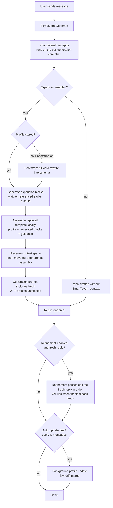

# SmartTavern

A single, self-contained SillyTavern UI extension that aims to deepen the roleplay and introduce the agentic-based workflow into your roleplay.

1. **Living per-chat character profiles** — a dynamic, LLM-maintained bio with a user-defined schema, stored **per chat** and fully independent of the parent character card.
2. **Dual reasoning pipelines** — two user-editable step lists, each entry an isolated LLM call, that run together without interfering:
   - **Expansion** (before the reply): steps generate context that assembles into a configurable prompt tail for the upcoming reply. Independent steps can run together; explicit output references preserve dependencies. SmartTavern **augments** SillyTavern's prompt assembly; presets and World Info keep working.
   - **Refinement** (after the reply): passes audit and surgically edit the freshly generated reply in order — optionally hidden behind a veil until the final pass lands.

No server plugin, no build step — install via the default extension installer.

The generation WILL take longer, since multiple agents will be reasoning and adding context or refining the actual reply. But you can surgically prompt an agent to focus on specific parts YOU don't like or YOU want to be attended more. From simple repetition and prose check, up to additional descriptions/realistic dialogue or whatever is annoying you personally.

---
## Screenshot

 


## Installation and quickstart

**Via the extension installer (recommended):**
`Extensions → Manage extensions → Install extension`, then paste the git repository URL.

**Manual:** copy this folder into

```
SillyTavern/public/scripts/extensions/third-party/SmartTavern/
```

and restart / reload SillyTavern.

Recommended companion: the built-in **Connection Manager** extension (enabled by default in recent ST builds). It stores the saved connection profiles that SmartTavern uses for per-step and per-updater routing. Without it, SmartTavern still works — every internal call simply uses the currently active connection (one warning is shown).

Right-click on the character avatar (long press on mobiles) will open the context window for you to configure.

## How it works



Key implementation facts (verified against ST 1.13–1.19 source):

- The extension registers a `generate_interceptor`. ST calls it with the **per-generation core chat array** — a filtered/mapped *copy* of the real history. The injected state block therefore feeds World Info scanning and the final prompt for that one generation **without ever leaking into the saved chat history**.
- **Two independent pipelines run together.** *Expansion* runs inside the interceptor before generation and injects its outputs into the reply prompt; *refinement* runs after the reply is rendered (`CHARACTER_MESSAGE_RENDERED`), editing the fresh draft in place. Each has its own step list, enable toggle and per-step Connection Manager routing — disabling either leaves the other fully functional.
- **Refinement (and the veil) only ever touches a freshly generated reply.** The interceptor marks each real generation; only the first rendered character reply after that mark is refined. Chat loads, scrollback, swipe views and a new chat's greeting (`first_message`) are never refined or veiled.
- The default position is **End of assembled reply prompt**. SmartTavern first inserts a marked, ephemeral reservation into the core chat so ST includes the tail in its context budgeting. At `CHAT_COMPLETION_PROMPT_READY`, it removes the reservation and appends the assembled tail as the last message with the selected role. Other preset instructions remain intact. Markers distinguish this request from unrelated internal requests.
- Text-completion mode uses `GENERATE_AFTER_COMBINE_PROMPTS`, formats the tail using the active instruct settings (or named plain text), and restores an assistant generation cue after it. If a custom formatter prevents safe relocation, markers are stripped and the assessment stays at its budgeted history position. Backend-specific post-processing may still reshape messages after these hooks; role behavior depends on the provider.
- The older history anchors remain available for comparisons. There, each block has its own output role and uses the injection header/footer. Prompt-end mode instead uses the **Prompt-tail role** and **Reply prompt-tail template** settings for the complete tail.
- Generation instructions always go to the block model as a user request. Only generated output is injected into the main reply prompt. Assistant context supplies prior assessments; it does not force a provider to import them into a private reasoning channel or accept fabricated thought signatures.
- Existing configurations migrate once to prompt-end injection with assistant role. Step prompts and connection profiles are preserved. The redundant final consolidation pass, its editor, and its saved settings have been removed: assembling the template makes no extra LLM call. After migration, manually chosen history anchors and role settings persist normally.
- The former single *Pipeline mode* migrated into the two independent pipelines: refinement users' step lists moved to **Refinement passes** (expansion gets its default preset back), while expansion users keep their steps and gain the default refinement preset. Both pipelines default to on and can be toggled separately.
- Profile updates fire on `MESSAGE_RECEIVED` once `chat.length - updatedAt >= updateInterval` messages have accumulated for the character who just replied. They run in the background and merge with **little-to-no personality drift** (Personality / Values / Aspirations / Fears are held stable by the updater prompt). When refinement is enabled the update is deferred until the passes finish, so the updater reads the refined reply.
- All internal LLM calls go through one adapter:
  - with a **Connection Manager profile id** → `ConnectionManagerRequestService.sendRequest()` against that saved API/preset/instruct (no global state mutation); Chat Completion structured output uses the `response_format: json_schema` override payload;
  - without one (or on any error) → `generateRaw()` on the active connection (`responseLength` = token budget, `jsonSchema` passed through, lenient JSON parsing as fallback).
- Group chats: profiles are keyed by member avatar filename; the drafting member is resolved from the global `name2` (which ST sets to the currently-generating member), falling back to the last non-user message author.
- **Living description override** (Settings → *Replace the card description with the living profile*): the character card's description text is swapped for the stored living profile inside the assembled prompt. This covers every channel the description travels — the Prompt Manager's **Char Description** entry (chat completion marker prompt), the instruct Context Template story string (text completion) and the `{{description}}` macro in custom prompts — because all of them end up containing the same description text ST computed in `Generate()`. The swap happens on the per-generation prompt copy at `CHAT_COMPLETION_PROMPT_READY` / `GENERATE_AFTER_COMBINE_PROMPTS`; **the stored card is never modified**, and without a profile the original description is used. In group chats every member with a stored profile gets their slice swapped (including merged group-card descriptions).

## Using the floating panel

Everything is summoned as a compact panel over the chat window — no drawer digging:

- **Right-click any character avatar** in the chat (long-press on touch devices) → quick menu: *Edit living bio*, *Edit pipeline*, *Update bio now*, *Last result*.
- Other entry points: **Extensions (wand) menu → SmartTavern**, the **Open SmartTavern panel** button in the extension settings drawer, and the `/st-hud` toggle.
- Tabs: **Profile** (the character's living bio, editable in place — manual edits save automatically with source `manual`), **Steps** (two editors — expansion steps and refinement passes; cards collapse on header click), **Schema** (profile field editor), **Results** (the latest run of each pipeline — dry run or captured from the last generation), **Settings** (everything else).
- Drag the header to move the panel; double-click the header to reset to the default (left-center) position. Tab and position are remembered.
- `Esc` closes the panel (native popups keep priority).
- On screens ≤ 900 px the panel becomes a near-fullscreen sheet and dragging is disabled.
- **Disable floating UI** (Settings tab) hides every floating entry point and makes `/st-hud` a no-op; the settings drawer stays available.

## Configuration

Full settings live in the floating panel (Settings tab); the **Extensions → SmartTavern** drawer keeps the enable toggle, the panel button and a status line.

| Setting | Meaning |
| --- | --- |
| Enable SmartTavern | Master toggle for the pipeline injection |
| Enable expansion | Master toggle for the pre-reply context pipeline (on by default) |
| Enable refinement | Master toggle for the post-reply editing pipeline (on by default) |
| Refinement display | **Veiled** (default): the fresh reply is blurred in chat until the final pass lands — pass progress shows as chips on the message and a hold-to-peek button can partially unblur it. **Off**: every pass lands visibly. The veil only ever appears on a freshly generated reply — never on chat loads or a new chat's greeting. |
| Allow hold-to-peek | Shows the hold-to-peek button on the veil (on by default) |
| That's enough (veil button) | Stops refinement immediately and keeps the last completed pass, or the original draft if no pass has finished. The unfinished pass is discarded. |
| Skip pass (veil / activity log button) | Cancels only the currently running refinement pass and continues to the next pass using the last accepted draft. Late responses from the skipped request are discarded. |
| Save refinement passes as swipes | Appends changed revisions to the message swipes. Veiled runs keep only draft + final so the swipes cannot spoil the result. |
| Auto-update profiles | Background maintenance on `MESSAGE_RECEIVED` |
| Bootstrap profile on first message | First generation for a character = complete rewrite of the card into the schema |
| Replace the card description with the living profile | Swaps the card's description text for the stored profile inside the assembled prompt (Char Description entry, story string, `{{description}}` macro). The card itself is never modified; needs a stored profile, which the pipelines (or a manual **Rebuild**) create. |
| Update every N messages | Cadence per character (default 12) |
| Pipeline / updater chat lookback | How many recent messages the step prompts / updater see (default 24) |
| Step / updater max tokens | Token budgets for internal calls (default 512 / 1024) |
| Injection position | End of assembled reply prompt (default), or a history anchor for comparisons |
| Prompt-tail role | Assistant (default), User, or System for the complete tail |
| Reply prompt-tail template | Editable template assembled locally; defaults to profile + `{{steps}}` + instructions to use the assessments for the upcoming reply without repeating the notes |
| Injection depth | Used only with custom history depth: 0 = after the newest message, 1 = before it |
| Injection name / header / footer | Settings for history positions; `{{char}}` and other macros resolve |
| Profile schema fields | Rows: name + description — the JSON schema is built from this list (defaults: Brief Summary, Appearance, Background, Personality incl. sexual preferences, Aspirations, Fears, Values) |
| Expansion steps | Cards: enabled, name, role, per-step lookback, connection profile, prompt; reorder / duplicate / delete; defaults: **Physical Condition** → **Mental Condition** |
| Refinement passes | Same cards minus the role selector (passes are strictly sequential and work on the draft); defaults: **Body & Spatial Awareness** → **Character & Psychological Authenticity** → **Prose & Wording Polish** |
| Step execution | Expansion only: parallel where independent (default), or sequential. `{{step:Name}}` waits for that earlier step; `{{steps}}` waits for all earlier steps. Refinement passes are always strictly sequential. Active-connection calls are serialized because ST temporarily changes shared generation settings. |
| Block role | Expansion steps only: role of each generated output when using a history anchor; prompt-end mode uses the global tail role. Refinement passes have no role selector. |
| Profile updater connection profile | Saved Connection Manager profile used by bootstrap/update/rebuild |
| Disable floating UI | Master switch for the floating panel, avatar context menu and wand-menu button |
| Run expansion / Run refinement (Results tab) | Dry run each pipeline: expansion runs its steps without injecting; refinement previews what the passes would change about the last character reply, saving nothing |

### Refinement guardrails

Every pass is checked locally before its reply or raw output can be saved or supplied to later passes. No additional LLM call is used. The checks reject empty replies, punctuation-only placeholders such as `<revised_reply>...</revised_reply>`, common "unchanged" placeholders, and unbalanced or repeated reply/audit tags. An explicit `<audit>PASS</audit>` without a reply wrapper still keeps the current draft.

Candidates are compared with **both the last accepted draft and the initial draft**, catching cumulative drift across passes. For references of at least 40 normalized characters, a reply is rejected if it is more than **40% shorter** or more than **twice as long**. For references of at least 120 characters, at least **35% of their character trigrams** must remain. Trigram overlap counts repeated fragments and works without word separators; case, whitespace and punctuation changes do not affect overlap. Length checks normalize case and whitespace. Very short drafts are exempt from relative comparisons to avoid noisy warnings.

A rejected result pauses refinement and shows the reasons with **Retry pass** and **Skip pass** buttons. Retry repeats the same prompt with the last accepted draft; skip keeps that draft and continues to the next pass. Exhausted generation errors also offer this choice. Rejected outputs never become swipes or `{{step:Name}}` values. Checks also apply to refinement dry runs. The activity log records rejection reasons; skipped rejected passes retain their reasons in Results.

**Skip pass** is also available while a request is running, in the veil and the expanded activity log. **That's enough** ends the whole refinement run. Global Stop and chat changes cancel a pending retry prompt. These conservative text checks detect obvious omissions and rewrites, but cannot verify factual or narrative correctness; an intentional large rewrite can also be rejected.

### Step prompt macros

| Macro | Resolves to |
| --- | --- |
| `{{char}}` / `{{user}}` | Target character / your persona name |
| `{{card}}` | The character card flattened to text |
| `{{definitions}}` | The full stored profile as `## Field` blocks |
| `{{chat}}` | The last N messages as `Name: text` |
| `{{field:Name}}` | A single profile field (case-insensitive) |
| `{{step:Step Name}}` | An earlier step's output (case-insensitive) |
| `{{steps}}` | Earlier completed outputs in a step prompt; all generated outputs in the reply-tail template, in configured order |
| `{{draft}}` / `{{original_draft}}` | Refinement passes only: the current working draft / the original reply before any pass touched it |

These macros also work in the reply-tail template. Include `{{steps}}` or selected `{{step:Name}}` references to supply the generated assessments. `{{step:Name}}` and `{{steps}}` resolve against the list of the pipeline the prompt belongs to — a refinement pass never sees expansion outputs, and vice versa. Unknown macros are left intact for SillyTavern's own substitution pass. The Results tab shows the assembled reply context (expansion) and the final refined reply (refinement) so you can inspect exactly what each pipeline produced.

### Per-step model routing

Each step **and** the profile updater can pin any saved **Connection Manager profile** (`Extensions → Connection Manager` → create profiles there first). The default `Active connection` option uses whatever API/model is currently connected. Quality over latency: there is deliberately no caching or fast path — every generation runs all enabled steps.

Use independent blocks for assessments that can use the same profile and conversation (for example, physical condition and scene constraints). Reference an earlier block only where its result is needed. The default mental-condition prompt explicitly references physical condition, so those two still run in order. Removing that reference and updating its task instructions makes them independent. The final reply model receives the blocks in configured order regardless of completion order.

## Slash commands

| Command | Alias | Effect |
| --- | --- | --- |
| `/smarttavern-profile [char]` | `/st-profile` | Show the stored profile in a popup |
| `/smarttavern-update [char]` | `/st-update` | Run a profile update now |
| `/smarttavern-rebuild [char]` | `/st-rebuild` | Full rewrite from the card (bootstrap prompt) |
| `/smarttavern-reset [char]` | `/st-reset` | Delete the stored profile |
| `/smarttavern-run` | `/st-run` | Dry run of every enabled pipeline (expansion, then refinement); shows raw outputs |
| `/smarttavern-hud` | `/st-hud` | Toggle the floating panel |

**smarttavern_dump**: open the browser console and run
`SillyTavern.getContext().registerDebugFunction`-registered **smarttavern_dump** from the debug menu — it prints settings + the chat profile store.

## Storage & privacy

- Global config: `extensionSettings.smarttavern` (in `settings.json`).
- Profiles: `chatMetadata.smarttavern = { version, profiles: { [avatar]: { fields, createdAt, updatedAt, source, lastDiff? } } }` — saved with the chat, invisible to the character card. `lastDiff` records the field-level before/after of the most recent background update (cleared by manual edits).
- No secrets are stored; connection profiles reference the Connection Manager's own records.
- Every generation makes up to `1 (bootstrap) + expansion steps + refinement passes` extra LLM calls — mind your provider quota/billing. Prompt-tail assembly makes no model call.

## Caveats

- **Structured output support varies by backend.** On Chat Completion sources SmartTavern sends `response_format: json_schema` for profile calls; providers that reject it produce a parse failure → the lenient parser (strip code fences, slice first `{` … last `}`) is the fallback, and failed updates keep the previous profile.
- Group-member detection via `name2` is how ST itself identifies the drafting member (same variable the core prompt builder reads), but it is not a documented extension API — if a group generation ever targets the wrong member, the fallback (author of the last non-user message) takes over.
- The reservation increases the prompt size by roughly the expanded template (profile + step outputs by default). It participates in ST's normal context budgeting. If ST removes the reservation, the tail is omitted rather than silently re-added beyond that budget. Hooks installed by other extensions after SmartTavern's hook may append further content.
- Stopping a run cancels retries and queued steps. Connection Manager requests receive an abort signal. The active-connection API cannot always abort an individual request; in that case its late result is discarded and the UI resumes immediately, while further active-connection calls wait for that request to settle.
- `extensions/shared.js` is internal to ST; the adapter prefers the context-exposed `ConnectionManagerRequestService` and degrades gracefully if it moves.
- The description override runs after ST's context budgeting, which counted the original description. A living profile larger than the card's description can therefore push the final prompt slightly over the budgeted size — keep an eye on the context meter if your profiles are much longer than the original descriptions. Descriptions shorter than 12 characters are left untouched (too risky to match textually). Prompt dry runs/inspectors (`dryRun`) and SmartTavern's own internal calls always see the original card description.

## Roadmap (out of v1)

Per-field immutability locks; update-diff preview before applying (SkyrimNet-style); drag-to-reorder for steps; `{{smarttavern:Field}}` macros usable in character cards/presets; per-step reasoning/thinking presets.

## License

AGPL-3.0 (matches SillyTavern).
