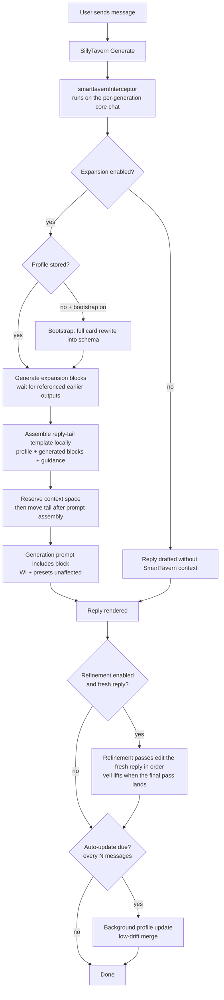

# SmartTavern

A single, self-contained SillyTavern UI extension that aims to deepen the roleplay and introduce the agentic-based workflow into your roleplay.

1. **Living per-chat character profiles** — a dynamic, LLM-maintained bio with a user-defined schema, stored **per chat** and fully independent of the parent character card.
2. **Dual reasoning pipelines** — two user-editable step lists, each entry an isolated LLM call, that run together without interfering:
   - **Expansion** (before the reply): steps generate context that assembles into a configurable prompt tail for the upcoming reply. Independent steps can run together; explicit output references preserve dependencies. SmartTavern **augments** SillyTavern's prompt assembly; presets and World Info keep working.
   - **Refinement** (after the reply): passes audit and surgically edit the freshly generated reply in order — optionally hidden behind a veil until the final pass lands.

No server plugin, no build step — install via the default extension installer.

The generation WILL take longer, since multiple agents will be reasoning and adding context or refining the actual reply. But you can surgically prompt an agent to focus on specific parts YOU don't like or YOU want to be attended more. From simple repetition and prose check, up to additional descriptions/realistic dialogue or whatever is annoying you personally.

---
## Screenshot

 


## Installation and quickstart

**Via the extension installer (recommended):**
`Extensions → Manage extensions → Install extension`, then paste the git repository URL.

**Manual:** copy this folder into

```
SillyTavern/public/scripts/extensions/third-party/SmartTavern/
```

and restart / reload SillyTavern.

Recommended companion: the built-in **Connection Manager** extension (enabled by default in recent ST builds). It stores the saved connection profiles that SmartTavern uses for per-step and per-updater routing. Without it, SmartTavern still works — every internal call simply uses the currently active connection (one warning is shown).

Right-click on the character avatar (long press on mobiles) will open the context window for you to configure.

## How it works



Key implementation facts (verified against ST 1.13–1.19 source):

- The extension registers a `generate_interceptor`. ST calls it with the **per-generation core chat array** — a filtered/mapped *copy* of the real history. The injected state block therefore feeds World Info scanning and the final prompt for that one generation **without ever leaking into the saved chat history**.
- **Two independent pipelines run together.** *Expansion* runs inside the interceptor before generation and injects its outputs into the reply prompt; *refinement* runs after the reply is rendered (`CHARACTER_MESSAGE_RENDERED`), editing the fresh draft in place. Each has its own step list, enable toggle and per-step Connection Manager routing — disabling either leaves the other fully functional.
- **Refinement (and the veil) only ever touches a freshly generated reply.** The interceptor marks each real generation; only the first rendered character reply after that mark is refined. Chat loads, scrollback, swipe views and a new chat's greeting (`first_message`) are never refined or veiled.
- The default position is **End of assembled reply prompt**. SmartTavern first inserts a marked, ephemeral reservation into the core chat so ST includes the tail in its context budgeting. At `CHAT_COMPLETION_PROMPT_READY`, it removes the reservation and appends the assembled tail as the last message with the selected role. Other preset instructions remain intact. Markers distinguish this request from unrelated internal requests.
- Text-completion mode uses `GENERATE_AFTER_COMBINE_PROMPTS`, formats the tail using the active instruct settings (or named plain text), and restores an assistant generation cue after it. If a custom formatter prevents safe relocation, markers are stripped and the assessment stays at its budgeted history position. Backend-specific post-processing may still reshape messages after these hooks; role behavior depends on the provider.
- The older history anchors remain available for comparisons. There, each block has its own output role and uses the injection header/footer. Prompt-end mode instead uses the **Prompt-tail role** and **Reply prompt-tail template** settings for the complete tail.
- Generation instructions always go to the block model as a user request. Only generated output is injected into the main reply prompt. Assistant context supplies prior assessments; it does not force a provider to import them into a private reasoning channel or accept fabricated thought signatures.
- Existing configurations migrate once to prompt-end injection with assistant role. Step prompts and connection profiles are preserved. The redundant final consolidation pass, its editor, and its saved settings have been removed: assembling the template makes no extra LLM call. After migration, manually chosen history anchors and role settings persist normally.
- The former single *Pipeline mode* migrated into the two independent pipelines: refinement users' step lists moved to **Refinement passes** (expansion gets its default preset back), while expansion users keep their steps and gain the default refinement preset. Both pipelines default to on and can be toggled separately.
- Profile updates fire on `MESSAGE_RECEIVED` once `chat.length - updatedAt >= updateInterval` messages have accumulated for the character who just replied. They run in the background and merge with **little-to-no drift** on fields marked **Stable** in the schema (defaults: Personality, Aspirations, Fears, Values), which the updater prompt holds essentially unchanged; all other fields may grow freely. When refinement is enabled the update is deferred until the passes finish, so the updater reads the refined reply.
- All internal LLM calls go through one adapter:
  - with a **Connection Manager profile id** → `ConnectionManagerRequestService.sendRequest()` against that saved API/preset/instruct (no global state mutation); Chat Completion structured output uses the `response_format: json_schema` override payload;
  - without one (or on any error) → `generateRaw()` on the active connection (`responseLength` = token budget, `jsonSchema` passed through, lenient JSON parsing as fallback).
- **Expansion and refinement own their sampling settings.** Each step has a **Sampling** button below its prompt, with temperature (default 0.7), repetition penalty (1), presence penalty (0), and frequency penalty (0). These calls use the saved connection profile's routing, API/model and credentials, without importing its generation preset or instruct settings. Other generation parameters use provider defaults. Prompt content comes from SmartTavern's system prompt and the expanded step prompt; history, character definitions and living profiles enter through macros. Provider prompt post-processing can still reshape messages. Providers differ in which sampling controls they support; repetition penalty is omitted for OpenAI, Claude and Gemini chat sources.
- **Active-connection step calls and fallbacks use the same isolated sampling.** They use ST's Chat/Text Completion request services with connection routing only, without changing global ST settings. Older builds or other active API types need a saved Connection Manager profile for these calls. Planner, profile maintenance, Story Director and other non-step calls retain their existing preset behavior.
- Refinement starts from the render event without blocking that event's completion. Active-connection requests can then wait safely for `GENERATION_ENDED`, rather than hitting the foreground wait's 60-second safety timeout. Passes remain sequential, and profile maintenance follows refinement.
- Group chats: profiles are keyed by member avatar filename; the drafting member is resolved from the global `name2` (which ST sets to the currently-generating member), falling back to the last non-user message author.
- **Living description override** (Settings → *Replace the card description with the living profile*): the character card's description text is swapped for the stored living profile inside the assembled prompt. This covers every channel the description travels — the Prompt Manager's **Char Description** entry (chat completion marker prompt), the instruct Context Template story string (text completion) and the `{{description}}` macro in custom prompts — because all of them end up containing the same description text ST computed in `Generate()`. The swap happens on the per-generation prompt copy at `CHAT_COMPLETION_PROMPT_READY` / `GENERATE_AFTER_COMBINE_PROMPTS`; **the stored card is never modified**, and without a profile the original description is used. In group chats every member with a stored profile gets their slice swapped (including merged group-card descriptions). When the override is active, the reply-tail's `{{definitions}}` is replaced with a short pointer to the character description, so the profile is not sent twice.

## Using the floating panel

Everything is summoned as a compact panel over the chat window — no drawer digging:

- **Right-click any character avatar** in the chat (long-press on touch devices) → quick menu: *Edit living bio*, *Edit pipeline*, *Update bio now*, *Guided update…*, *Last result*.
- Other entry points: **Extensions (wand) menu → SmartTavern**, the **Open SmartTavern panel** button in the extension settings drawer, and the `/st-hud` toggle.
- Tabs: **Profile** (the character's living bio, editable in place — manual edits save automatically with source `manual`; each field header has a **wand** to regenerate that field alone and a **compass** for a guided regeneration with extra direction from you; the optional **Guidance** box feeds the next **Update** / **Rebuild** as one-shot extra direction that never overrides the schema or the card), **Scene** (the shared [scene state](#scene-state): editable facts with pin / lock / delete, Add fact, Track now, Clear scene, undo list), **Steps** (two editors — expansion steps and refinement passes; cards collapse on header click), **Schema** (profile field editor), **Results** (the latest run of each pipeline — dry run or captured from the last generation), **Settings** (everything else).
- Drag the header to move the panel; double-click the header to reset to the default (left-center) position. Tab and position are remembered.
- `Esc` closes the panel (native popups keep priority).
- On screens ≤ 900 px the panel becomes a near-fullscreen sheet and dragging is disabled.
- **Disable floating UI** (Settings tab) hides every floating entry point and makes `/st-hud` a no-op; the settings drawer stays available.

## Configuration

Full settings live in the floating panel (Settings tab); the **Extensions → SmartTavern** drawer keeps the enable toggle, the panel button and a status line.

| Setting | Meaning |
| --- | --- |
| Enable SmartTavern | Master toggle for the pipeline injection |
| Enable expansion | Master toggle for the pre-reply context pipeline (on by default) |
| Enable refinement | Master toggle for the post-reply editing pipeline (on by default) |
| Refinement display | **Veiled** (default): the fresh reply is blurred in chat until the final pass lands — pass progress shows as chips on the message and a hold-to-peek button can partially unblur it. **Off**: every pass lands visibly. The veil only ever appears on a freshly generated reply — never on chat loads or a new chat's greeting. |
| Allow hold-to-peek | Shows the hold-to-peek button on the veil (on by default) |
| That's enough (veil button) | Stops refinement immediately and keeps the last completed pass, or the original draft if no pass has finished. The unfinished pass is discarded. |
| Skip pass (veil / activity log button) | Cancels only the currently running refinement pass and continues to the next pass using the last accepted draft. Late responses from the skipped request are discarded. |
| Save refinement passes as swipes | Appends changed revisions to the message swipes. Veiled runs keep only draft + final so the swipes cannot spoil the result. |
| Auto-update profiles | Background maintenance on `MESSAGE_RECEIVED` |
| Bootstrap profile on first message | First generation for a character = complete rewrite of the card into the schema |
| Replace the card description with the living profile | Swaps the card's description text for the stored profile inside the assembled prompt (Char Description entry, story string, `{{description}}` macro). The card itself is never modified; needs a stored profile, which the pipelines (or a manual **Rebuild**) create. |
| Update every N messages | Cadence per character (default 12) |
| Pipeline / updater chat lookback | How many recent messages the step prompts / updater see (default 24) |
| Step / updater max tokens | Upper bound for each internal call's output (default 8192 / 8192). Every call is also capped to the connection's context window and to the provider's reported output limit, and retried with a lower limit when the provider rejects the requested one. |
| Fall back to the active connection | When a step's or updater's saved connection profile fails, retry on the active connection (on by default). Each fallback shows an entry in the activity log and a toast. |
| Injection position | End of assembled reply prompt (default), or a history anchor for comparisons |
| Prompt-tail role | Assistant (default), User, or System for the complete tail |
| Reply prompt-tail template | Editable template assembled locally; defaults to profile + `{{steps}}` + instructions to use the assessments for the upcoming reply without repeating the notes |
| Injection depth | Used only with custom history depth: 0 = after the newest message, 1 = before it |
| Injection name / header / footer | Settings for history positions; `{{char}}` and other macros resolve |
| Profile schema fields | Rows: name + description + a **Stable** checkbox — the JSON schema is built from this list (defaults: Brief Summary, Appearance, Background, Personality incl. sexual preferences, Aspirations, Fears, Values). Fields marked Stable are held essentially unchanged by the background updater; Personality, Aspirations, Fears and Values are stable by default. |
| Expansion steps | Cards: enabled, name, role, per-step lookback, connection profile, prompt; reorder / duplicate / delete; defaults: **Physical Condition** → **Mental Condition** |
| Refinement passes | Same cards minus the role selector (passes are strictly sequential and work on the draft), plus an **Edit mode** select: **Surgical edits** (default) or **Full rewrite**. Defaults: **Body & Spatial Awareness** → **Character & Psychological Authenticity** → **Prose & Wording Polish** |
| Step execution | Expansion only: parallel where independent (default), or sequential. `{{step:Name}}` waits for that earlier step; `{{steps}}` waits for all earlier steps. Refinement passes are always strictly sequential. Isolated step requests can overlap without changing ST's global generation settings. |
| Step sampling | Button below each expansion/refinement prompt: temperature, repetition penalty, presence penalty, frequency penalty. Values are saved per step and preserved when duplicating. These replace preset sampling for step calls; supported controls depend on the API/model. |
| Step reasoning | Checkbox beside each expansion/refinement connection selector, **off by default**. On requests maximum effort through the provider adapter. If that value is explicitly rejected, retry on the same connection with high and remember the successful choice for that connection/model until reload. Off requests disabled thinking, rather than merely hiding thoughts. Models/adapters that cannot disable thinking report an error; Off is never silently replaced with low effort. The checkbox is unavailable for Text Completion connections. |
| Block activation / keywords | Expansion steps only: **Always** (default), **Keywords** (runs only when a keyword matches the last N messages; an empty list never runs) or **Planner decides** (see [Lean context](#lean-context)). |
| Activation scan depth | How many of the latest non-system messages keyword activation and keyword-matched fields scan (default 2, 1–20). |
| Reuse when unchanged / `{{previous}}` | Expansion steps only; off by default. The model may answer `UNCHANGED` to reuse this step's previous output. See [Lean context](#lean-context). |
| Block priority | Expansion steps only (default 50, 0–100): which blocks the reply-tail budget drops first. Only used while the budget is on. |
| Reply-tail token budget | Approximate token cap of the prompt-end reply tail (default 0 = off, 0–32000). |
| Field inject / keywords | Schema rows: **Always** (default for existing configs), **When relevant** or **Never**, plus optional keywords — what the *reply model* sees of the profile. |
| Block role | Expansion steps only: role of each generated output when using a history anchor; prompt-end mode uses the global tail role. Refinement passes have no role selector. |
| Profile updater connection profile | Saved Connection Manager profile used by bootstrap/update/rebuild |
| Scene tracker | Background call after each character reply that records scene facts (on for new installs, off for existing installs until enabled; see [Scene state](#scene-state)) |
| Scene tracker connection profile | Connection Manager profile for the tracker (empty = active connection) |
| Track every N replies / lookback / max tokens | Tracker cadence (default 1, 1–20, per chat), messages it reads (default 4, 1–20) and output budget (default 1024) |
| Max scene facts | Cap on the resolved scene (default 40, 10–200); the least recently set unpinned facts drop out first |
| Scene state in the reply tail | Off (default) or On: a `[Scene state]` section in the prompt-end tail (priority 70 for the tail budget) |
| Agent engine | Agent tab: **Planner** (default), **GM — thinks between turns (background)** or **Legacy**. The GM is opt-in because every tick is an extra background call; upgrading never changes your engine, and switching engines never deletes data (see [GM engine](#gm-engine)). |
| GM tick mode | **Every reply** (default), **Every Nth reply** (N = 2–20, counted per chat) or **Armed** (only after **Think next turn** / `/smarttavern-think`; the arm is consumed when the tick starts) |
| GM task | Editable prompt section for the GM tick (`gmTask`) |
| GM / fit-check / agent connection profile | Connection Manager profiles for the GM tick (empty = agent profile), for the small send-time branch check (empty = GM profile) and the shared fallback (empty = active connection) |
| Wait for the GM (ms) | Send time: how long to wait for a tick that is still running (default 10000, 0–60000); after that the planner runs and the late tick is cancelled |
| GM tools | The Agent tab's tool switches also cover `clock` and `npc_intent`; they exist only while the engine is GM. Budgets (iterations, tool calls, timeout, lookback, brief word cap) are shared with the Legacy agent. |
| Disable floating UI | Master switch for the floating panel, avatar context menu and wand-menu button |
| Run expansion / Run refinement (Results tab) | Dry run each pipeline: expansion runs its steps without injecting; refinement previews what the passes would change about the last character reply, saving nothing |

### Reasoning control

Reasoning is separate from the XML editing contract: a model can think before producing edit tags. On may increase latency substantially. Native Claude and Gemini use ST's effort-to-thinking-budget mapping; some models require reasoning or their adapter cannot explicitly disable it. Custom OpenAI-compatible endpoints receive an explicit `reasoning_effort` body field. Unsupported Off requests surface for review instead of retrying with thinking enabled. OpenAI reasoning modes omit incompatible temperature settings without changing the saved control. Planner, profile maintenance and other non-step calls retain their existing behavior.

### Refinement guardrails

Every completed refinement pass is checked only for an empty reply payload. An explicit `<audit>PASS</audit>` without a reply wrapper keeps the current draft. There are no length, similarity, placeholder, repetition, or tag-format filters for refinement. Other internal calls retain their generation sanity checks.

An empty result or exhausted generation error pauses refinement with **Retry pass**, **Skip Pass**, and **Review** buttons. Review opens the returned output in a scrollable window with **Accept**, **Retry**, and **Skip Pass**. Accept uses the reviewed result and continues; when it contains no reply, Accept keeps the current draft. Retry repeats the same prompt using the last accepted draft. Skip discards the failed output and continues to the next pass. Only accepted outputs become swipes or `{{step:Name}}` values. The same workflow applies to dry runs without changing chat.

**Skip pass** is also available while a request is running, in the veil and the expanded activity log. **That's enough** ends the whole refinement run. Global Stop and chat changes cancel pending rejection and review windows.

Each refinement pass streams progress to the activity display and the reply veil: **Waiting for the provider**, **Reasoning** when thinking tokens arrive, **Audit** when audit output arrives, and **Rewriting reply** when edit operations or revised prose arrive. Stages follow observable output, so a pass may skip stages (for example, a clean audit needs no rewrite). Providers that hide reasoning or buffer their response remain on Waiting until visible output arrives. Retries and connection fallback reset the status to Waiting.

### Step prompt macros

| Macro | Resolves to |
| --- | --- |
| `{{char}}` / `{{user}}` | Target character / your persona name |
| `{{card}}` | The character card flattened to text |
| `{{definitions}}` | The full stored profile as `## Field` blocks |
| `{{chat}}` | The last N messages as `Name: text` |
| `{{field:Name}}` | A single profile field (case-insensitive) |
| `{{step:Step Name}}` | An earlier step's output (case-insensitive) |
| `{{previous}}` | Expansion steps: this step's previous output in this chat, or `(none yet)` (see [Lean context](#lean-context)) |
| `{{steps}}` | Earlier completed outputs in a step prompt; all generated outputs in the reply-tail template, in configured order |
| `{{draft}}` / `{{original_draft}}` | Refinement passes only: the current working draft / the original reply before any pass touched it. In surgical passes `{{draft}}` renders the numbered paragraphs; `{{draft_plain}}` gives the unnumbered working draft, `{{draft_paragraphs}}` forces the numbered rendering in any pass |
| `{{scene}}` | The shared scene state as `key: value` lines (`location`, `time`, `weather` first), or `(no scene facts yet)` — see [Scene state](#scene-state) |
| `{{story}}` | The compiled scene directive text (Story Director; never contains secrets or future chapters) |
| `{{must}}` / `{{beat}}` / `{{chapter}}` / `{{ledger}}` | The required event / the current beat text / the current chapter line / the fact ledger |

These macros also work in the reply-tail template. Include `{{steps}}` or selected `{{step:Name}}` references to supply the generated assessments. `{{step:Name}}` and `{{steps}}` resolve against the list of the pipeline the prompt belongs to — a refinement pass never sees expansion outputs, and vice versa. Unknown macros are left intact for SillyTavern's own substitution pass. The Results tab shows the assembled reply context (expansion) and the final refined reply (refinement) so you can inspect exactly what each pipeline produced.

### Surgical refinement (edit modes)

Every pass picks how it may change the draft — the point is speed: a pass that touches 10% of the reply should not re-emit (and re-bill, and re-wait for) the other 90%.

**Full rewrite** is the classic contract: the model reasons inside `<audit>…</audit>` and returns the complete revised reply inside `<revised_reply>…</revised_reply>`, or `<audit>PASS</audit>` to keep the draft.

**Surgical edits** (the default for the preset passes and new passes) splits the draft into paragraphs automatically (blank lines; fenced code blocks stay atomic; single-newline drafts fall back to line granularity) and numbers them:

```
<p id="1">Alice stood beside the open window.</p>
<p id="2">She turned toward the door.</p>
```

The model then returns only what changes:

- `<edit id="2">She spun toward the door.</edit>` — the complete replacement text for paragraph 2
- `<delete id="3"/>` — drop a paragraph
- `<insert after="1">A new paragraph.</insert>` (`after="end"` appends)
- `<audit>PASS</audit>` — nothing needs changing; unchanged paragraphs are **never** re-emitted

For a phrase or sentence, prefer an exact text replacement:

```xml
<replace id="1"><find>stood beside the open window</find><with>sat beside the open window</with></replace>
```

`<find>` must match exactly once in that paragraph, including whitespace, punctuation and markup. Include more context if the phrase repeats. `<with></with>` deletes the matched chunk. Multiple replacements may target the same paragraph when they do not overlap; all refer to the draft as it appeared at the start of the pass. Surrounding text stays unchanged. Do not combine replacements with another operation on the same paragraph.

The patch is validated (ids must exist, no conflicting operations, no empty paragraph edits) and applied with the draft's original paragraph separators preserved. Missing, ambiguous or overlapping text matches reject the entire patch. Invalid patches are treated like any rejected pass: the Retry / Skip / Review popup opens with the exact issue, so even small or old models cannot corrupt the reply — worst case the pass is retried or skipped. `<revised_reply>` remains honored in surgical mode as a full-rewrite escape hatch, and models that ignore the protocol and echo the numbered draft, wrap it in one big `<edit>`, or add prose around their tags are all repaired into the same patch format instead of failing.

Default surgical prompts request operation tags only, without a written audit explanation. Existing unmodified surgical presets upgrade automatically; custom prompts remain intact. Actual latency depends on the model and its reasoning settings; smaller replacements reduce output tokens but do not eliminate the cost of reading the draft. To reduce calls further, combine checks into one pass. To reduce input, lower each pass's chat lookback or omit unnecessary definitions. Refinement passes run sequentially so later passes can inspect earlier edits.

The parser is deliberately hardened for weak/reasoning models (e.g. DeepSeek R1): unclosed tags salvage to end-of-output, `<think>` reasoning blocks are stripped, unquoted or misquoted attributes still parse, and there is no JSON anywhere in the protocol — a tag grammar cannot be corrupted the way a half-emitted JSON object can.

### Per-step model routing

Each step **and** the profile updater can pin any saved **Connection Manager profile** (`Extensions → Connection Manager` → create profiles there first). The default `Active connection` option uses whatever API/model is currently connected. Quality over latency: there is deliberately no caching or fast path — every generation runs all enabled steps.

Use independent blocks for assessments that can use the same profile and conversation (for example, physical condition and scene constraints). Reference an earlier block only where its result is needed. The default mental-condition prompt explicitly references physical condition, so those two still run in order. Removing that reference and updating its task instructions makes them independent. The final reply model receives the blocks in configured order regardless of completion order.

### Story Director

For chats that keep dying because nobody is pushing the story: the **Story** tab crafts a scenario once, then keeps the world moving without you being the GM.

- **Craft story** — one architect call turns the character (card + living profile + recent chat + your seed) into a bible: premise, tone, secrets, a cast with private agendas, and a chapter arc with observable exit conditions.
- **Next beat** — one director call compiles the next concrete, observable event (max ~45 words) plus two harder escalations and a ≤15-word fact. It also judges whether the chapter's exit condition looks met and says so in a toast.
- **Chapter End** — closes the chapter and posts a complete new playable situation as a character message, like a greeting. The opening establishes the tone, setting and immediate events while leaving player choices open.
- **Next chapter** — closes the current chapter (its outcome joins the ledger) and writes the next chapter's opening beat. On the last chapter it appends a 3-chapter sequel arc instead of dead-ending.

The reply model **never sees the bible**: secrets, cast agendas and future chapters exist only in the Director's prompts. Each generation gets a short (~140-word) scene directive appended as the **final** section of the prompt: the story frame, at most five ledger facts, and either the event this reply MUST show (→ beat, or an escalation once you idle for `storyIdleTurns` character replies) or a "keep developing" line once the beat is delivered. With refinement on, a built-in **Directive Enforcement** pass checks the fresh reply against the required event and weaves it in with minimal edits when missing; a pass that shows the event marks the beat delivered and its fact joins the ledger. Swiping or regenerating the message a beat was delivered in re-arms it as pending automatically. Everything (beat text, escalations, premise, chapters, cast) is editable in the tab and autosaves; the read-only **Directive preview** shows exactly what the reply model will receive next. Any story error fails open — the generation proceeds without a directive.

## Lean context

Four opt-in features that shrink what is sent to the reply model and what the expansion steps cost. Existing setups behave exactly as before until you change the new settings (migrations set the old behaviour: every block and field **Always**, nothing reused, no budget).

**Block activation** (expansion steps). Each step has an *Activation*: **Always**, **Keywords** or **Planner decides**. Keyword lists are separated by commas or newlines; an entry wrapped as `/pattern/flags` is a regular expression (put a regex that contains a comma on its own line), anything else is a case-insensitive substring. A **Keywords** step runs only when a keyword appears in the last *Activation scan depth* non-system messages; with no keywords it never runs. A **Planner decides** step runs unless the planner skips it with `## Skip: Exact block name` (optionally followed by a one-line reason); it always runs when the planner is off, fails or the block name is not skippable (other skips are ignored with a notice). Skipped blocks do not count toward the five-block limit, so the planner may use the freed slots; the planner also runs for a full set of five when it may skip blocks. A block that references `{{step:Name}}` of a skipped or untriggered block still runs; the macro resolves to empty. Results ("Block activation") and the activity log list `Skipped by planner: X — reason` and `Not triggered: Y`.

**Per-field inject modes** (Schema tab). A field's *Inject* mode decides what the reply model sees: the description override and `{{definitions}}` in the reply-tail template and history header. Internal step prompts, refinement passes, the planner and the updater always get the full profile. **When relevant** fields are sent when the planner lists them with `## Fields: Name, Name` or their keywords match the scanned messages; when the planner did not run, failed or sent no `## Fields` heading, a relevant field without keywords is sent anyway. The selection is made once per generation; the description slot and the tail use the same serialization, so the tail still swaps a duplicate profile for a pointer. New installs and **Restore defaults** use: Brief Summary and Personality always, Appearance / Aspirations / Fears / Values when relevant, Background never.

**Reuse unchanged assessments**. With *Reuse when unchanged* on, `{{previous}}` holds the step's previous output (`(none yet)` otherwise) and a reply of exactly `UNCHANGED` (or `UNCHANGED` followed only by punctuation) makes the step reuse it, logged as "reused (unchanged)". The default Physical / Mental Condition prompts include a *Previous assessment* section and the instruction (saved steps with the exact old default prompt are upgraded once; custom prompts are untouched). Outputs are stored for real generations only, in `chatMetadata.smarttavern.stepMemory`, anchored to the last chat message at that time. A stored output applies only while that message is still in the chat unchanged and the new generation is anchored after it — so it carries over to the next turn but not to a swipe or regenerate of the same reply, an edited message or a rewound chat (those see `(none yet)`, and an `UNCHANGED` answer becomes empty).

**Reply-tail token budget**. With a budget above 0 the prompt-end tail is measured (about 3.5 characters per token) per section: the story directive and required events are never dropped; the Turn Brief has priority 90, saved answers 80, the profile inside the tail 60 and each expansion block its *Priority* (default 50). While over budget, whole sections are dropped lowest priority first (ties: the later one first) by re-expanding the template without them; text is never cut. Results shows the estimated tokens per section and a "Tail budget: dropped X, Y (≈N tokens)" line, also written to the activity log. The budget does not apply to history-anchor injection positions, and the profile is not counted as droppable when the description override already carries it.

## Scene state

One **shared scene store** per chat holds the established, observable facts of the current scene: `location`, `time`, `weather`, and per character `<Name>.position`, `<Name>.clothing`, `<Name>.injuries`, `<Name>.inventory`, `<Name>.knows`, `<Name>.mood`. Keys match case-insensitively (the first-seen casing is kept). Three authors write to it, and each fact shows who set it last (tracker / agent / user badge in the **Scene** tab):

- **Scene tracker** — a background call after each finalized character reply (after refinement when refinement runs, in the same place and order as the profile auto-update; never for narration, user or system messages). It reads the current scene, the participants, the key conventions and the last few messages and answers with tags only: `<set key="Alice.position">kneeling by the fire</set>`, `<remove key="Alice.inventory"/>` or `<none/>`. Quote-grounded facts only, never plans or speculation, values of at most 20 words, at most 12 operations per run. The parser tolerates think blocks, code fences, odd quoting and unclosed tags. Runs never overlap within a chat (a tick that finds one running is skipped), and a result is discarded when the reply was swiped or edited in the meantime.
- **Legacy agent** — `update_scene` writes into the same store, so the Legacy agent behaves as before (it reads the shared facts, including the tracker's).
- **You** — edit values, add facts, pin, lock or delete them in the **Scene** tab.

**Rewind-safe.** Every fact is anchored to the saved chat message it was recorded at (its index and its exact text) and applies only while that message is still there unchanged. Swiping, regenerating, editing or deleting the reply silently drops its facts, and facts recorded earlier apply again; facts apply in message order and an empty value is a removal. The tracker then simply runs again for the new reply. Your own edits are anchored to the **last** chat message, so they are rewind-safe too (they disappear if that message is regenerated). Because facts are anchored, **Clear scene** appends removal facts for every unpinned key instead of truncating the store: it is one undoable step and rewinding past it brings the earlier scene back.

**Pin and lock.** *Pinned* keys are never evicted by the fact cap. *Locked* keys cannot be set or removed by the tracker or the agent (the attempt is skipped and noted in the activity log); only you can change them. Pin and lock lists are per chat and are not rewound.

**Fact cap.** `Max scene facts` (default 40, 10–200) is applied to the **resolved** scene when it is read: beyond the cap, the least recently set unpinned keys drop out of the active scene. This is a pure read-time view — nothing is deleted, rewinds stay exact and no extra facts are written. (The stored fact list itself is bounded at 1000, dropping facts of messages that no longer exist first.)

**Where the scene goes.**

- `{{scene}}` — `key: value` lines, `location` / `time` / `weather` first, then alphabetical; `(no scene facts yet)` when empty. Available in expansion step prompts, refinement passes and the reply-tail template. The default expansion step prompts are **not** changed: add `{{scene}}` to your own prompts where you want it.
- The expansion planner's context gets a `[SCENE STATE — established facts; data]` section when facts exist.
- The built-in **Directive Enforcement** pass shows the scene state next to the Turn Brief.
- **Scene state in the reply tail** (Settings, default **Off**): adds a `[Scene state]` section to the prompt-end tail, before the Turn Brief and the directive, unless your tail template already contains `{{scene}}`. It is a droppable section with priority 70 for the [tail budget](#lean-context) (below saved answers 80 and the Turn Brief 90, above the profile 60 and a default block 50). With a history injection position it is injected as its own block, like saved answers.
- The Legacy agent's planning prompt and the Agent tab's scene view read the shared store.

**Cost and defaults.** The tracker is one extra LLM call per tracked reply. It is **on for new installs** and **off for installs that existed before this feature** (a one-time migration keeps upgrades from spending money silently): turn it on under Settings → Scene state. Settings: tracker enable, connection profile (empty = active connection), track every N replies (1–20, default 1; counted per chat), lookback (default 4 messages, 1–20), max tokens (default 1024), max scene facts, scene in tail. **Track now** (Scene tab or `/smarttavern-track`) runs the tracker on the latest character reply immediately, ignoring the every-N counter and the enable switch.

Existing `agentScene` facts of a chat move into the shared store (as agent facts) the first time the chat's scene is read, and the old array is removed.

## Expansion planner and quick narration

The **Agent** tab defaults to **Planner** for new and upgraded installations. It makes one planning call before expansion, reading your existing block names/prompts, the character card and living profile, the current compiled story directive, and up to **24 recent visible messages**. Oldest messages are removed when the input exceeds the connection's context budget. Context-limit errors can trigger up to three shorter-history retries.

The planner adds temporary prompts only for important missing context. **Zero additions is a valid result.** At most **five expansion blocks total** run in Planner mode: enabled, nonempty saved blocks take priority, then additions fill any remaining slots. If more than five saved blocks are enabled, only the first five run and a notice appears in Results/activity. Saved prompts are never rewritten or deleted. Refinement remains entirely user-configured and has no new limit.

Generated prompts use the agent connection and normal expansion token budget. They receive shared character, story, and recent-chat context automatically. Independent blocks can run in parallel; `{{step:Earlier Block}}` and `{{steps}}` retain their dependency semantics. Results shows the accepted prompts and any planner failures or truncation notices. Malformed plans fall back to saved blocks, without a format-repair loop. The writing model receives expansion outputs, not planner reasoning or a Turn Brief.

When only the player can supply important missing context, the planner can return `## User: Short name` followed by a direct question. This uses the same plain-text heading format as `## Expansion:`, with no JSON or tool schema. A compact, mobile-friendly dialog shows the question, a text field, and **Submit / Skip**. A submitted answer applies to the current reply only, unless the player ticks **Keep for future replies in this chat** in the dialog; kept question-and-answer pairs are saved in this chat's SmartTavern metadata and supplied to the planner, expansion blocks, and reply model on later turns, including after reload. Skip continues without inventing an answer. Questions count toward the five-block limit; later blocks wait for earlier questions and can reference them with `{{step:Short name}}`. Dry runs, swipes, regenerations, and continuations reuse kept answers but never open questions or save new answers. Stopping generation or changing chats closes an open question.

**Always**, **Armed**, and **Off** control planning. Armed mode is triggered with **Plan next reply** or `/smarttavern-think`; dry runs do not consume the armed flag. Planning requires expansion to be enabled. Use **Planner task** to guide which information gaps deserve attention.

**Extensions (magic wand) → SmartTavern: Introduce scene…** accepts a request such as “skip a few days and introduce an unexpected visitor.” **Write scene** makes a direct prose call using the agent connection and appends a narrator message. It bypasses expansion and refinement, leaves player choices open, and does not advance Story Director's chapter, beat, or ledger. Cancel while it runs, or retry in the same dialog after a failure. Pending scenes are discarded if the conversation changes. This action works in either agent engine, including when automatic planning is off.

Select **GM** in the Agent tab for background planning between turns (see [GM engine](#gm-engine)), or **Legacy** to restore the original tool agent. Its settings, memories, scene state, and rulings remain available; switching engines does not erase them. The sections below describe Legacy behavior.

## GM engine

The **GM** engine (Agent tab → Agent engine → *GM — thinks between turns (background)*) moves the thinking agent out of the send path. After each finalized character reply a **tick** runs in the background while you read and type; it prepares the *next* turn, and sending a message only has to **read** the result.

**The tick** runs after the reply is final (after refinement, the profile update and — when it runs — the scene tracker for that reply, so it reads the updated scene). It is a tool-using loop built on the Legacy agent's machinery: the same tolerant tool-call parser, tool registry and budgets (max iterations, max tool calls, timeout), with a GM system prompt and tag output. The GM sees the character card and living profile, the **story bible including secrets, cast agendas and chapters** and the compiled directive, the scene state, its own clocks and NPC agendas, saved rulings, saved player answers, recent chat (agent lookback) and its previous prepared brief for continuity. Tools: everything the Legacy agent has (`roll_dice`, `consult_character`, `consult_expert`, `update_scene`, `introduce_npc`, memory, `character_ruling`) plus:

- `clock` — progress clocks (`create` with a name, 2–12 segments and a concrete consequence; `advance` by 1–3; `resolve` / `delete`). A clock that fills during a tick is marked full and its consequence becomes a **required event** of the prepared brief.
- `npc_intent` — an NPC's private agenda (at most 40 words), kept per chat and shown to the GM on later ticks.
- `ask_user` does **not** open a popup in a tick: it queues one question that is asked at send time (below).

The GM finishes with tags, never JSON: `<brief>` (about 100 words of guidance), up to three `<must>` events, up to four `<branch if="condition on the player's next message">outcome</branch>`, an optional `<fields>` list (which *When relevant* profile fields matter) and `<skip>` entries (planner-activated expansion blocks to skip). Dice rolled during the tick are recorded by code and attached to the brief — dice in model text are never trusted.

**Send time.** The prepared brief is valid only if the reply it was made after is unchanged (same index and exact text) and is still the last character reply before your new message; swipes and regenerations of the *next* reply reuse it, while editing or swiping the anchor reply invalidates it. If a tick for that reply is still running, SmartTavern shows *Waiting for the GM…* for up to **Wait for the GM** milliseconds. Then:

1. A queued question is asked once with the planner's Submit / Skip dialog (never on dry runs, swipes, regenerations or continuations, which reuse a stored answer).
2. If the brief has branches, one small **fit check** (`gmFitProfileId`, 256 output tokens) sees your latest message and the branch conditions and answers `<use>1,3</use>` or `<use>none</use>`. Any failure includes no branches — the general brief still applies.
3. The Turn Brief is compiled from the brief, the chosen branch outcomes, the musts, the code-recorded dice and the question/answer, capped by the brief word cap, and injected through the same path as the Legacy agent: its musts and dice feed **Directive Enforcement**, and `{{brief}}` / `{{rolls}}` work. The prepared `<fields>` / `<skip>` choices take the planner's place for [lean context](#lean-context); **no planner call is made**.

If there is no valid brief (the tick is off-cycle, failed, timed out or the anchor changed), the **expansion planner runs exactly as in Planner mode**, so a turn never depends on the GM. The reason is shown in the Agent tab status line, the activity log and the Results tab.

**Safety.** The reply model never sees the bible, the GM transcript, NPC agendas or clocks — only the compiled Turn Brief (and the story directive, as before). Every GM failure fails open, and background ticks never raise unhandled errors. A tick is cancelled when the chat changes or SmartTavern is disabled, and its result is discarded if the anchor reply changes while it thinks. One tick runs at a time per chat; a newer reply preempts the running one.

**Agent tab (GM).** A status line (last tick, running, last planner fallback), **Think now** (a tick on the last character reply, any tick mode), **Think next turn** (arms Armed mode), **Discard prepared brief**, the prepared brief with its musts, branches and dice, the clock list (+1 / resolve / delete and an *Add clock* row), editable NPC agendas, the queued question and a collapsible transcript of the last tick. `/smarttavern-gm` shows the prepared brief, clocks, agendas and queued question in a popup.

**Cost.** Every tick is a tool loop of up to *max iterations* calls plus the tools' own calls, and each send with branches adds one tiny fit-check call; use *Every Nth reply* or *Armed* mode to limit it. Dice, clocks and agendas are plain data in the chat metadata (see Storage).

### Tool transport (native function calling)

By default the GM calls tools by writing `<tool name="…">{json}</tool>` tags (**Tags**, setting `gmToolTransport: 'tags'`), which works with every connection. Two opt-in alternatives (Agent tab → GM → *Tool transport*):

- **Native** — the tools are sent as real OpenAI-format `tools` (function definitions built from the same registry, with JSON-schema arguments) and the model answers with tool calls; their results go back as `role: "tool"` messages. A final tool, **`submit_brief`** (`brief`, `musts[]`, `branches[{if, then}]`, `fields[]`, `skips[]`), ends the tick and goes through the same normalization as the tag output (same word caps and refusal rule). When the iterations run out, the model is asked once more with *only* `submit_brief` offered and `tool_choice` forcing it (`required`, `any` for Claude); if it still does not submit, one tags-format final request finishes the tick.
- **Auto** — native when the GM connection supports it, otherwise tags (silently).

Native needs a **Chat Completion Connection Manager profile** (GM, else agent profile) whose source is on SillyTavern's own tool-calling list (OpenAI, Claude, Gemini via AI Studio/Vertex, OpenRouter, Mistral, Cohere, DeepSeek, Groq, xAI, custom OpenAI-compatible and others) and whose *prompt post-processing* keeps tool calls (none, or the `…_tools` variants). Requests are non-streaming and read the raw backend response, so Claude `tool_use` blocks, Gemini `functionCall` parts and OpenAI/Cohere `tool_calls` are all understood. The active connection (no profile) is not supported in this version and uses tags. Budgets, per-turn caps and the working-copy isolation of a tick are unchanged. If the **first** native request fails (a model or proxy that rejects `tools`), the whole tick is rerun on tags with one activity note — *Native tool calling unavailable — using tags*; choosing **Native** on a connection that cannot do it also falls back to tags and says why once.

## MCP bridge (optional server plugin)

The **MCP bridge** lets the GM call tools of [Model Context Protocol](https://modelcontextprotocol.io) servers (stdio or HTTP) — for example a wiki lookup for canon facts. Browser extensions cannot start MCP servers, so a small **SillyTavern server plugin** (`server-plugin/`) owns the connections and exposes four JSON routes under `/api/plugins/smarttavern-mcp/` (`GET /status`, `GET /tools`, `POST /call`, `POST /reload`; SillyTavern's normal login/CSRF protection applies). Everything is opt-in: with MCP off, or without the plugin, nothing changes.

**Security.** MCP servers run **with your user's permissions** on the SillyTavern machine. Only configure servers you trust, give them the narrowest `allowTools` list that works, and treat servers whose tools write or delete things as dangerous: mark them `"write": true` (their tools are blocked in dry runs) and keep their budget small. The plugin only reaches servers named in `mcp-servers.json` and only tools those servers really list (and `allowTools` permits). MCP output reaches the model labelled *data, not instructions*, but it is still third-party text.

**Install.**

1. Copy the `server-plugin` folder to `SillyTavern/plugins/smarttavern-mcp`.
2. In that folder run `npm install` (it needs `@modelcontextprotocol/sdk`).
3. Set `enableServerPlugins: true` in SillyTavern's `config.yaml`.
4. Copy `mcp-servers.example.json` to `mcp-servers.json` and edit it (below).
5. Restart SillyTavern (the console prints `[smarttavern-mcp] ready: N server(s) configured`).
6. In SmartTavern, Agent tab → engine **GM** → switch **MCP tools (GM only)** on and press **Refresh**.

**`mcp-servers.json`.**

```json
{ "servers": [
  { "name": "wiki", "transport": "stdio", "command": "node", "args": ["servers/wiki.js"], "cwd": ".",
    "env": { "WIKI_DEFAULT": "wikipedia", "WIKI_LANG": "en" } },
  { "name": "docs", "transport": "http", "url": "https://example.com/mcp", "headers": { "Authorization": "Bearer …" },
    "allowTools": ["search"], "write": false, "timeoutMs": 30000 }
] }
```

`transport` is `stdio` (`command`, `args`, `env`, `cwd` — relative paths resolve against the plugin folder) or `http` (`url`, `headers`; Streamable HTTP, falling back to legacy SSE). Optional per server: `allowTools` (default: every tool the server lists), `write` (default `false`: tools are exposed as read-only; `true` marks them as writers, blocked in dry runs) and `timeoutMs` (default 30000). Connections are made lazily on first use, reused, re-established after a crash, and closed when SillyTavern exits. Results are text (images and resources are summarized as `[image]` / `[resource uri]`) capped at 8000 characters. A server that fails to start only loses its own tools.

**In the GM.** Tools appear as `mcp__<server>__<tool>` (sanitized to `[a-zA-Z0-9_-]`, at most 64 characters, with a short hash on collisions) described as `[MCP <server>] …`, in both the tag catalog and native function definitions. They share one per-tick budget (**MCP calls per tick**, default 3, 0–10). Only the **GM** engine gets them (not the planner or the Legacy agent). The Agent tab lists the servers with their connection state and every tool with a checkbox (unticked tools are never offered; stored as `mcpDisabledTools: ["server:tool"]`). **Refresh** re-checks the plugin and tool list; **Reload config** re-reads `mcp-servers.json` and reconnects.

**Bundled wiki server (`servers/wiki.js`).** A read-only MCP server for Wikipedia and Fandom wikis (both run MediaWiki), enabled in the example config as `wiki`. The GM uses it for canon facts about known fictional characters and public figures. `wiki_search {query, wiki?, lang?, limit ≤ 5}` returns titles and short snippets; `wiki_page {title, wiki?, lang?, section?, maxChars ≤ 6000}` returns plain text (Wikipedia via TextExtracts; Fandom, which lacks it, via the parsed wikitext flattened to text; `section` returns just that section). `wiki` is `wikipedia` (default), a Fandom subdomain such as `starwars`, or a full `https://…/api.php` URL (public hosts only — localhost and IP addresses are refused). Defaults come from `WIKI_DEFAULT` / `WIKI_LANG` in the server's `env`. It sends the user agent `SmartTavern-MCP/1.0`, times out after 10 seconds and caches results for 15 minutes. Wiki text is data, not instructions, and is licensed (Wikipedia: CC BY-SA; Fandom: usually CC BY-SA) — respect each wiki's terms of use and do not hammer it.

**Tests.** `npm test` runs the plugin's tests too; the ones that spawn MCP servers need `npm install` in `server-plugin/` and skip cleanly without it. No test touches the network.

## Legacy agent and slash commands

The **Agent task** field exposes an editable part of the planning prompt, saved for future turns. The agent sees the available lorebook names and relevant entries from user-authored chat, character and global lorebooks; `memory_search` can retrieve more. User-authored entries remain read-only.

The **Agent** tab configures pre-reply thinking: Always, Armed (one-shot), or Off;
connection profiles; tool switches; and iteration/time budgets. The agent can roll
binding dice, consult the character, ask a question, introduce an NPC, and manage
its own memories in the shared chat lorebook. Its compiled Turn Brief appears before
the Scene Directive; only the brief reaches the reply model. **Skip thinking** keeps
completed rolls and answers. Armed mode is triggered by **Think next reply** or
`/smarttavern-think`. `/smarttavern-roll 2d6+1` is informational, and
`/smarttavern-memory` lists agent memories. Memory changes are undoable in the Agent
tab. Dry runs cannot write memory or consume the armed flag.

The agent receives complete expansion outputs and retains its last thought in full.
The activity log and transcript show returned reasoning, including the separate
reasoning channel when provided by the connection. The timeout defaults to **0
(unlimited)**; set a positive millisecond value in the Agent tab to impose a deadline.
Existing installations using the former 90-second default migrate to unlimited once;
custom deadlines are preserved. **Skip thinking** and Stop remain available.

Click the generation activity chip to inspect completed calls. Entries show a short
preview; click a heading to expand its output, or choose **Read full output** for a
larger reading window. Closing the activity panel keeps the log and expanded entries
intact. The chip hides when refinement finishes or is skipped; other completed activity
hides after a short idle delay. **Clear log** removes retained entries explicitly. Activity is kept in memory until cleared or the page is reloaded.

### Rulings ledger (Legacy agent)

The **character oracle** answers behavioral questions about a character ("how does she react when flattered?") from the card, the living profile, existing rulings and a chat excerpt only; it never sees the Story Director's bible, scene state or the agent's scratchpad. Each answer is validated and saved as a **ruling** in this chat's ledger (per character in group chats). Rulings can be pinned, edited, deleted and undone from the Agent tab, which keeps an undo log of ledger changes.

- **Reuse:** before a new oracle call, the question is matched against existing active or tentative rulings; a match at or above the **reuse threshold** (default 0.6) is reused without a new call.
- **Surfacing:** relevant rulings are added to the Turn Brief as "Established behavior" when they score at or above the **surface threshold** (default 0.34), at most **Surfaced per brief** rulings (default 2).
- **Cap and pruning:** the ledger holds up to the **Ledger cap** per chat (default 60); when it is full, superseded rulings go first, then tentative ones, then the least-used unpinned. Tentative rulings expire after 30 new messages, and pinned rulings are never evicted.
- **Manual use:** **Consult now** in the Agent tab and `/smarttavern-ruling <question>` ask the oracle directly and save the result. The tool switch and the **Rulings per turn** limit are in the Agent tab; the oracle has its own optional connection profile.

The agent has three GM capabilities:

- **Agent dice:** agent rolls use an unmodified d20. Only **1 -- complete failure**
  and **20 -- critical success** have fixed meanings. The agent declares the difficulty
  before rolling and interprets results **2-19** itself, then includes concrete
  consequences in its brief. Code imposes no middle bands or success thresholds.
  The roll and declared difficulty reach the brief, `{{rolls}}`, and reply enforcement.
  Advantage/disadvantage uses the kept d20. `/smarttavern-roll` still accepts general dice expressions for informational rolls.
- **Scene state:** `update_scene` stores one key/value fact with an exact conversation
  quote as evidence. Use keys such as `location`, `time`, `Alice.position`, or
  `Alice.inventory`; `remove: true` removes an obsolete fact. These facts persist in
  chat metadata (the shared [scene store](#scene-state)) and appear in planning prompts and the Agent tab. Planned events and
  unplayed dice consequences must wait until established in chat. Facts from edited,
  deleted or replaced source messages stop applying; earlier recorded versions can
  apply again when rewinding. Dry runs cannot persist changes.
- **Custom consultation:** `consult_expert` sends a question, context and optional
  assumptions to another LLM call, alongside character, conversation, expansion and
  scene context. It returns an assessment, reasons, uncertainties and alternatives.
  Advice does not automatically become canon or a binding event, and the consultant
  cannot call tools. The Agent tab offers an optional expert connection profile
  (otherwise it uses the agent profile). At most one consultation runs per turn.

All three capabilities have tool switches in the Agent tab. Scene updates are
limited to three per turn and share the existing total tool-call budget.

Thinking adds up to the configured number of planning calls, plus character/NPC
consults and retries. Use Armed mode to control latency. `npm test` runs the complete
suite.

| Command | Alias | Effect |
| --- | --- | --- |
| `/smarttavern-profile [char]` | `/st-profile` | Show the stored profile in a popup |
| `/smarttavern-update [char]` | `/st-update` | Run a profile update now |
| `/smarttavern-rebuild [char]` | `/st-rebuild` | Full rewrite from the card (bootstrap prompt) |
| `/smarttavern-reset [char]` | `/st-reset` | Delete the stored profile |
| `/smarttavern-run` | `/st-run` | Dry run of every enabled pipeline (expansion, then refinement); shows raw outputs |
| `/smarttavern-craft <seed>` | `/st-craft` | Craft a Story Director bible for this chat |
| `/smarttavern-beat <note>` | `/st-beat` | Compile the next story beat (optional steering note) |
| `/smarttavern-chapter` | `/st-chapter` | Close the current chapter and write the opening beat of the next |
| `/smarttavern-story` | `/st-story` | Show the directive the reply model will receive |
| `/smarttavern-think` | `/st-think` | Arm the agent for the next reply (one-shot; requires Armed mode). With the GM engine in Armed tick mode it arms the next GM tick |
| `/smarttavern-gm` | `/st-gm` | Show the GM's prepared brief, clocks, NPC agendas and queued question |
| `/smarttavern-ruling <question>` | `/st-ruling` | Ask the character oracle a behavioral question and save the ruling |
| `/smarttavern-roll <dice>` | `/st-roll` | Roll dice now (informational, not binding) |
| `/smarttavern-memory` | `/st-memory` | List the agent-owned lorebook memory entries of this chat |
| `/smarttavern-scene` | `/st-scene` | Show the resolved scene state in a popup |
| `/smarttavern-track` | `/st-track` | Run the scene tracker on the latest character reply now |
| `/smarttavern-hud` | `/st-hud` | Toggle the floating panel |

**smarttavern_dump** is registered as a SillyTavern debug function: open it from SillyTavern's debug menu (User Settings → Debug menu). It prints the SmartTavern settings and the chat's store (including stored profiles) to the browser console.

## Storage & privacy

- Global config: `extensionSettings.smarttavern` (in `settings.json`).
- Profiles: `chatMetadata.smarttavern = { version, profiles: { [avatar]: { fields, createdAt, updatedAt, source, lastDiff? } } }` — saved with the chat, invisible to the character card. `lastDiff` records the field-level before/after of the most recent background update (cleared by manual edits).
- Story: `chatMetadata.smarttavern.story = { v, bible, chapterIndex, beat, ledger, turnsSinceDelivery, seed, createdAt }` — one story per chat, saved with it.
- Reusable assessments: `chatMetadata.smarttavern.stepMemory = { [step name]: { text, sourceIndex, sourceText } }`.
- Kept planner answers: `chatMetadata.smarttavern.userAnswers` (only answers the player chose to keep).
- Scene state: `chatMetadata.smarttavern.scene = { facts: [{ key, value, evidence, sourceIndex, sourceText, by: 'tracker' | 'agent' | 'user', at }], pinned: [keys], locked: [keys], log: [undo entries, max 30], tick }` — shared by the tracker, the Legacy agent and the Scene tab. Formerly the Legacy agent's `agentScene` array, which migrates into `facts` (as `by: 'agent'`) when first read.
- GM engine: `chatMetadata.smarttavern.gm = { prepared: { anchorIndex, anchorText, brief, musts, branches: [{ if, then }], rolls, fields, skips, createdAt, model, npc, voice, reaction, qa }, previous (the brief that was in force when the newest reply was generated, so swipes of that reply still find theirs), clocks: [{ id, name, segments, filled, consequence, status: 'active' | 'filled' }], agendas: { [npc name]: { intent, at } }, pendingQuestion: { question, at } | null, tick, transcript (last tick, capped), status }`. It holds secrets-adjacent GM data (agendas, clocks) that is only ever sent to the GM's own calls.
- Legacy agent: the rulings ledger in `rulings` / `agentRulingSeq` / `agentRulingLog`, the memory undo log in `agentMemoryLog` (all under `chatMetadata.smarttavern`), and agent-owned memory entries as flagged entries in the chat's bound lorebook (user-authored entries are never modified).
- No secrets are stored; connection profiles reference the Connection Manager's own records.
- MCP bridge settings (`mcpEnabled`, `mcpCallsPerTurn`, `mcpDisabledTools`) and `gmToolTransport` live in the global settings; the server list and its credentials live only in the plugin's `mcp-servers.json` on the server, never in chats or settings.
- Every generation makes up to `1 (bootstrap) + expansion steps + refinement passes` extra LLM calls, plus the scene tracker call per tracked reply (when enabled), the planner call (Planner engine), the GM engine's background tick after each reply (a tool loop) plus one small fit-check call per send when the brief has branches, the legacy agent's planning iterations and consults (character, expert, oracle), the built-in Directive Enforcement pass when a story beat is pending, and any retries or connection fallbacks — mind your provider quota/billing. Prompt-tail assembly makes no model call.

## Caveats

- **Structured output support varies by backend.** On Chat Completion sources SmartTavern sends `response_format: json_schema` for profile calls; providers that reject it produce a parse failure → the lenient parser (strip code fences, slice first `{` … last `}`) is the fallback, and failed updates keep the previous profile.
- Group-member detection via `name2` is how ST itself identifies the drafting member (same variable the core prompt builder reads), but it is not a documented extension API — if a group generation ever targets the wrong member, the fallback (author of the last non-user message) takes over.
- The reservation increases the prompt size by roughly the expanded template (profile + step outputs by default). It participates in ST's normal context budgeting. If ST removes the reservation, the tail is omitted rather than silently re-added beyond that budget. Hooks installed by other extensions after SmartTavern's hook may append further content.
- Stopping a run cancels retries and queued steps. Connection Manager requests receive an abort signal. The active-connection API cannot always abort an individual request; in that case its late result is discarded and the UI resumes immediately, while further active-connection calls wait for that request to settle.
- `extensions/shared.js` is internal to ST; the adapter prefers the context-exposed `ConnectionManagerRequestService` and degrades gracefully if it moves.
- The description override runs after ST's context budgeting, which counted the original description. A living profile larger than the card's description can therefore push the final prompt slightly over the budgeted size — keep an eye on the context meter if your profiles are much longer than the original descriptions. Descriptions shorter than 12 characters are left untouched (too risky to match textually). Prompt dry runs/inspectors (`dryRun`) and SmartTavern's own internal calls always see the original card description. With the override active, a profile that the reply tail would repeat (the default tail template's `{{definitions}}`) is replaced inside the tail by a short pointer to the character description; custom tails that paraphrase the profile are not deduplicated.

## Roadmap (out of v1)

Hard per-field locks (Stable is a soft lock); update-diff preview before applying (SkyrimNet-style); drag-to-reorder for steps; `{{smarttavern:Field}}` macros usable in character cards/presets.

## License

AGPL-3.0 (matches SillyTavern).
