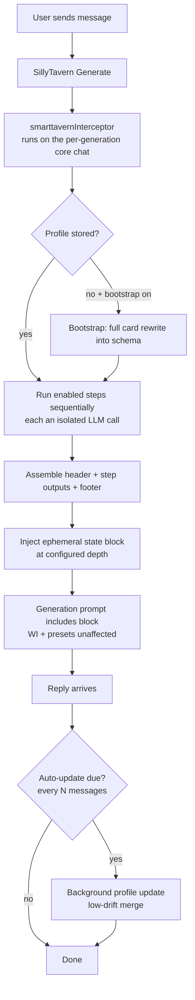

# SmartTavern

A single, self-contained SillyTavern UI extension that replicates SkyrimNet-style "living world" logic:

1. **Living per-chat character profiles** — a dynamic, LLM-maintained bio with a user-defined schema, stored **per chat** and fully independent of the parent character card.
2. **Chained multi-pass reasoning pipeline** — user-editable steps, each an isolated LLM call executed strictly in order, whose outputs are assembled into a state block injected into the final reply generation. SmartTavern **augments** SillyTavern's prompt assembly; presets, World Info and everything else keep working.

No server plugin, no build step — install via the default extension installer.

---

## Installation and quickstart

**Via the extension installer (recommended):**
`Extensions → Manage extensions → Install extension`, then paste the git repository URL.

**Manual:** copy this folder into

```
SillyTavern/public/scripts/extensions/third-party/SmartTavern/
```

and restart / reload SillyTavern.

Recommended companion: the built-in **Connection Manager** extension (enabled by default in recent ST builds). It stores the saved connection profiles that SmartTavern uses for per-step and per-updater routing. Without it, SmartTavern still works — every internal call simply uses the currently active connection (one warning is shown).

Right-click on the character avatar (long press on mobiles) will open the context window for you to configure.

## How it works



Key implementation facts (verified against ST 1.13–1.19 source):

- The extension registers a `generate_interceptor`. ST calls it with the **per-generation core chat array** — a filtered/mapped *copy* of the real history. The injected state block therefore feeds World Info scanning and the final prompt for that one generation **without ever leaking into the saved chat history**.
- The block is inserted as a plain `{ is_system: true }` message at `injectDepth` (default `1` = right before the newest message in the generation prompt). For `swipe` generations ST pops the swiped message first, so depth 1 lands at the very end — exactly where the next reply continues.
- Profile updates fire on `MESSAGE_RECEIVED` once `chat.length - updatedAt >= updateInterval` messages have accumulated for the character who just replied. They run in the background and merge with **little-to-no personality drift** (Personality / Values / Aspirations / Fears are held stable by the updater prompt).
- All internal LLM calls go through one adapter:
  - with a **Connection Manager profile id** → `ConnectionManagerRequestService.sendRequest()` against that saved API/preset/instruct (no global state mutation); Chat Completion structured output uses the `response_format: json_schema` override payload;
  - without one (or on any error) → `generateRaw()` on the active connection (`responseLength` = token budget, `jsonSchema` passed through, lenient JSON parsing as fallback).
- Group chats: profiles are keyed by member avatar filename; the drafting member is resolved from the global `name2` (which ST sets to the currently-generating member), falling back to the last non-user message author.

## Using the floating panel

Everything is summoned as a compact panel over the chat window — no drawer digging:

- **Right-click any character avatar** in the chat (long-press on touch devices) → quick menu: *Edit living bio*, *Edit pipeline*, *Update bio now*, *Last result*.
- Other entry points: **Extensions (wand) menu → SmartTavern**, the **Open SmartTavern panel** button in the extension settings drawer, and the `/st-hud` toggle.
- Tabs: **Profile** (the character's living bio, editable in place — manual edits save automatically with source `manual`), **Steps** (pipeline step editor, cards collapse on header click), **Schema** (profile field editor), **Results** (the latest pipeline run — dry run or captured from the last generation), **Settings** (everything else).
- Drag the header to move the panel; double-click the header to reset to the default (left-center) position. Tab and position are remembered.
- `Esc` closes the panel (native popups keep priority).
- On screens ≤ 900 px the panel becomes a near-fullscreen sheet and dragging is disabled.
- **Disable floating UI** (Settings tab) hides every floating entry point and makes `/st-hud` a no-op; the settings drawer stays available.

## Configuration

Full settings live in the floating panel (Settings tab); the **Extensions → SmartTavern** drawer keeps the enable toggle, the panel button and a status line.

| Setting | Meaning |
| --- | --- |
| Enable SmartTavern | Master toggle for the pipeline injection |
| Auto-update profiles | Background maintenance on `MESSAGE_RECEIVED` |
| Bootstrap profile on first message | First generation for a character = complete rewrite of the card into the schema |
| Update every N messages | Cadence per character (default 12) |
| Pipeline / updater chat lookback | How many recent messages the step prompts / updater see (default 24) |
| Step / updater max tokens | Token budgets for internal calls (default 512 / 1024) |
| Injection depth | 0 = after the newest message, 1 = before it (default) |
| Injection name / header / footer | How the state block is framed; `{{char}}` and other macros resolve |
| Profile schema fields | Rows: name + description — the JSON schema is built from this list (defaults: Brief Summary, Appearance, Background, Personality incl. sexual preferences, Aspirations, Fears, Values) |
| Pipeline steps | Cards: enabled, name, connection profile, prompt; reorder / duplicate / delete; defaults: **Physical Condition** → **Mental Condition** |
| Profile updater connection profile | Saved Connection Manager profile used by bootstrap/update/rebuild |
| Disable floating UI | Master switch for the floating panel, avatar context menu and wand-menu button |
| Run pipeline now (Results tab) | Dry run: executes the steps and shows raw outputs without injecting |

### Step prompt macros

| Macro | Resolves to |
| --- | --- |
| `{{char}}` / `{{user}}` | Target character / your persona name |
| `{{card}}` | The character card flattened to text |
| `{{definitions}}` | The full stored profile as `## Field` blocks |
| `{{chat}}` | The last N messages as `Name: text` |
| `{{field:Name}}` | A single profile field (case-insensitive) |
| `{{step:Step Name}}` | An earlier step's output (case-insensitive) |

Unknown macros are left intact so SillyTavern's own macro pass still runs over the final prompt.

### Per-step model routing

Each step **and** the profile updater can pin any saved **Connection Manager profile** (`Extensions → Connection Manager` → create profiles there first). The default `Active connection` option uses whatever API/model is currently connected. Quality over latency: there is deliberately no caching or fast path — every generation runs all enabled steps.

## Slash commands

| Command | Alias | Effect |
| --- | --- | --- |
| `/smarttavern-profile [char]` | `/st-profile` | Show the stored profile in a popup |
| `/smarttavern-update [char]` | `/st-update` | Run a profile update now |
| `/smarttavern-rebuild [char]` | `/st-rebuild` | Full rewrite from the card (bootstrap prompt) |
| `/smarttavern-reset [char]` | `/st-reset` | Delete the stored profile |
| `/smarttavern-run` | `/st-run` | Dry run of the pipeline; shows raw step outputs |
| `/smarttavern-hud` | `/st-hud` | Toggle the floating panel |

**smarttavern_dump**: open the browser console and run
`SillyTavern.getContext().registerDebugFunction`-registered **smarttavern_dump** from the debug menu — it prints settings + the chat profile store.

## Storage & privacy

- Global config: `extensionSettings.smarttavern` (in `settings.json`).
- Profiles: `chatMetadata.smarttavern = { version, profiles: { [avatar]: { fields, createdAt, updatedAt, source } } }` — saved with the chat, invisible to the character card.
- No secrets are stored; connection profiles reference the Connection Manager's own records.
- Every generation makes up to `1 (bootstrap) + steps` extra LLM calls — mind your provider quota/billing.

## Caveats

- **Structured output support varies by backend.** On Chat Completion sources SmartTavern sends `response_format: json_schema` for profile calls; providers that reject it produce a parse failure → the lenient parser (strip code fences, slice first `{` … last `}`) is the fallback, and failed updates keep the previous profile.
- Group-member detection via `name2` is how ST itself identifies the drafting member (same variable the core prompt builder reads), but it is not a documented extension API — if a group generation ever targets the wrong member, the fallback (author of the last non-user message) takes over.
- The injection increases the prompt size by roughly the profile + step outputs; if a context budget is exceeded, ST trims oldest history first and the (newest) block survives.
- `extensions/shared.js` is internal to ST; the adapter prefers the context-exposed `ConnectionManagerRequestService` and degrades gracefully if it moves.

## Roadmap (out of v1)

Parallel execution for independent steps; per-field immutability locks; update-diff preview before applying (SkyrimNet-style); drag-to-reorder for steps; profile-value diff view; `{{smarttavern:Field}}` macros usable in character cards/presets; per-step reasoning/thinking presets.

## License

AGPL-3.0 (matches SillyTavern).
